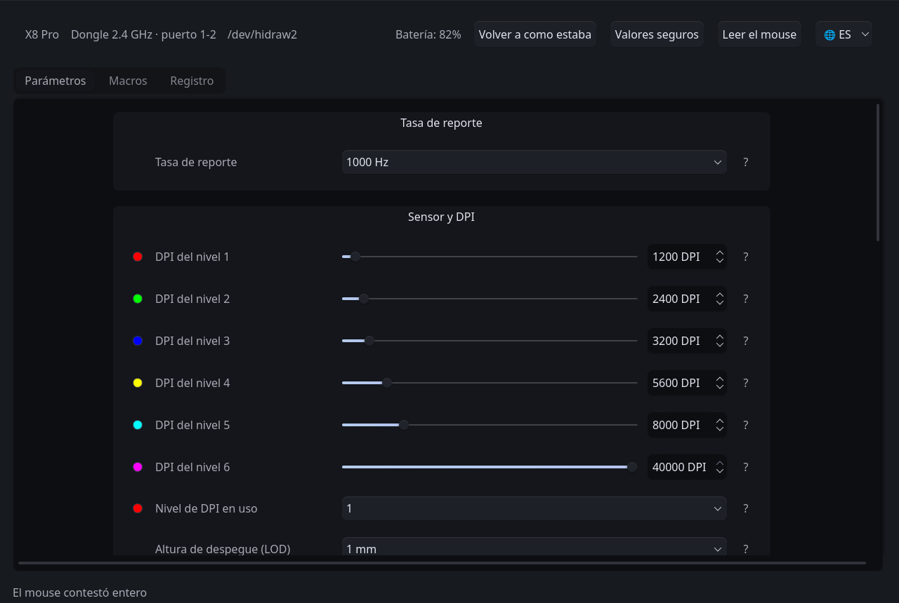

<!-- traduce: README.md sha256:90b16d4af088e89a44aca46b4c2f816ed6e4e13f5ffa7df3fa8b4461f9d5488d -->
<p align="center"></p>

# LinShark

[Español](README.md) · **English** · [简体中文](README.zh-CN.md)

> This is a translation. The original is [`README.md`](README.md), in Spanish,
> the language of the project: if the two disagree, the Spanish one is right.

Native configuration suite, user-space driver and [reverse
engineering][reverse] documentation for the mice of the **LXDDZ / Beken**
ecosystem —the ones configured from the szslxd-tech.com web platform, sold under
the Attack Shark, MambaSnake and INX brands— on GNU/Linux systems.

It manages the hardware parameters ([DPI resolution][dpi], [polling
rate][polling], button assignment, macro sequences, power timers and sensor
registers) through a graphical interface or command-line tools, without the
manufacturer's proprietary software or the helper service it requires.

**Independent, unofficial** project · [GPL-2.0-or-later](#license) · version
0.1.0, no published release.

> **Current scope:** there is **one measured and integrated model**, the
> **Attack Shark X8 Pro**. The manufacturer's catalog declares 46 others that
> share the *bundle* and the protocol, but the program does not talk to them:
> see [Supported models](#supported-models).



## Contents

1. [Supported models](#supported-models)
2. [What it configures](#what-it-configures)
3. [What is deliberately not offered](#what-is-deliberately-not-offered)
4. [Installation and use](#installation-and-use)
5. [Repository structure](#repository-structure)
6. [How to add a model](#how-to-add-a-model)
7. [Why a program of its own](#why-a-program-of-its-own)
8. [Method and safeguards](#method-and-safeguards)
9. [Automated tests](#automated-tests)
10. [Reference documentation](#reference-documentation)
11. [License](#license), [legal notice](#legal-notice) and [glossary](#glossary)

---

## Supported Models

| Model | Brand | USB (dongle / cable) | Status | Profile |
| :--- | :--- | :--- | :--- | :--- |
| **X8 Pro** | Attack Shark | `1d57:fa65` / `1d57:2126` | Measured and integrated, both paths verified against the hardware | [`perfiles/x8pro.py`](driver/src/linshark/perfiles/x8pro.py) |

The other **46 models** in the manufacturer's catalog —`X3Pro`, `X8SE`, `G3`,
`X11SE`, `X8Plus` and the rest, spread across Attack Shark, MambaSnake and
INX— are identified by name and ID in
[`dispositivos.py`](driver/src/linshark/dispositivos.py), read from the
manufacturer's *bundle*, **but none of them has ever been measured**. They share
the web application and the helper service, so it is reasonable to expect the
method to work for them; that is not the same as knowing how to talk to one.

If the model is not in the table, the program does not talk to it. The way to
add it is in [How to add a model](#how-to-add-a-model).

---

## What It Configures

The capabilities below are those of the **Attack Shark X8 Pro**, the measured
model. The ranges and the fields offered are declared by each profile, not by
the code: on another model they will be its own.

- **Sensor and performance:**
  - Eight resolution levels in the DPI block (six loaded from the factory on
    this model), from 100 to 40 000 [DPI][dpi] in steps of 50, with selection of
    the active level.
  - Polling rate selectable among the seven the profile declares (125 to
    8000 Hz) over the 2.4 GHz link; over the cable the ceiling is 1000 Hz, a
    limit imposed by the USB descriptor itself (*Full Speed*, `bInterval` of
    1 ms). Four of those rates are verified with the kernel HID subsystem's
    clock.
  - Sensor registers: lift-off distance (1 mm or 2 mm), ripple control, angle
    snapping and motion sync.
  - Button response time ([*debounce*][debounce]) from 4 to 50 ms, in steps
    of 2.
- **Buttons and macros:**
  - Reassignment of the 18 button slots, including the order of the scroll
    wheel, with the manufacturer's restriction of always keeping a left click
    assigned.
  - Composite keyboard shortcuts (modifiers plus an [HID][hid] *usage*) that the
    operating system receives as real key presses.
  - Recording and writing of macro event lists, with a live recorder in the
    graphical interface.
- **Power:**
  - Short sleep timer (0.5 to 30 min) and deep sleep (1 to 60 min), independent
    of each other.
- **Connectivity and monitoring:**
  - Identification of the connection method (2.4 GHz dongle or cable) and of
    the physical port by reading only [`sysfs`][sysfs], without opening the
    device or sending it anything.
  - Automatic reconnection on [hot-plug][hotplug] changes, and a warning when
    the cable takes over the channel.
  - Battery status, and the asynchronous notifications the firmware itself
    sends.
- **Interface:**
  - PySide6 application with its own theme or the desktop's, built entirely
    from the data model: it does not know any field by name.
  - Interface available in Spanish, English and Simplified Chinese.

## What Is Deliberately Not Offered

- **RGB color control on this model.** The bytes are written, the device
  acknowledges them and reading back returns them changed, but the chassis
  lights nothing (MEDIDO: measured). The control is removed by profile
  (`dispositivos.Perfil.campos_ausentes`), not by code: on a model with working
  RGB it comes back without touching the interface.
- **Changing the connection method (2.4 GHz or cable).** There is no such
  command in the manufacturer's *bundle*, so the official client cannot do it
  either: it is changed with the mouse's physical button.
- **Lighting mode, indicator colors and enabling of DPI levels.** They are
  constant across the 76 captured writes of the official client. Without a
  capture that changes them there is no possible Stage 2, and writing them
  would amount to inventing bytes.
- **Wake-up mode (cmd 7).** It cannot be read, and without reading back no
  verification is possible.

---

## Installation and Use

### Requirements

- A GNU/Linux distribution with [`udev`][udev] and the [`hidraw`][hidraw]
  subsystem.
- Python 3.10 or later (the installer checks it).
- PySide6, only for the graphical interface. If the distribution packages it,
  the installer uses that package; otherwise it gets it through pip.
- The 2.4 GHz dongle, or the mouse connected by cable.

It is developed and measured on CachyOS with a Wayland session. It has not been
tested on other distributions or on X11.

### Quick start

```bash
sudo ./driver/instalar/install.sh          # installs into /opt/linshark, plus the udev rule
linshark-gui                               # the application
```

`--solo-probar` shows what the installer would do without changing anything,
and `sudo ./driver/instalar/uninstall.sh` reverts it. The installation leaves
`linshark-gui` and `linshark` in `/usr/local/bin`, plus an entry in the
applications menu; `linshark-gui --sin-tema` follows the desktop theme.

The application **does not read the mouse when it opens**: it waits for the
**Read mouse** button.

The window is translated; the command-line tools and their messages are in
Spanish.

> **Risk.** This program writes to the non-volatile memory of a physical
> device. The [safeguards](#method-and-safeguards) exist precisely because of
> that, but they do not cancel the risk: whoever runs it takes it.

**Why the `udev` rule is needed.** The configuration channel is a
`/dev/hidrawN` node that by default only root can open. The rule gives the
user's session (`uaccess`) access to the mouse's configuration interface and
nothing else, so the program does not run as root. Without it the application
still opens, says the permissions are missing and offers to install it with a
button.

### Running from the repository

With PySide6 available, and without installing anything:

```bash
sudo ./driver/scripts/instalar-udev.sh   # the permissions rule, needed once
./driver/linshark-gui
```

### Command line

Every write follows the same cycle as the interface: backup, confirmation,
write, read-back and comparison. Some examples:

```bash
driver/scripts/donde-esta-el-mouse.py                 # bus diagnosis, does not touch the device
driver/scripts/respaldar.py                           # full backup of the state
driver/scripts/primera-escritura.py --comando dpi --nivel 1 --valor 1600
```

The full list of tools is in
[`driver/README.en.md`](driver/README.en.md#command-line).

### The bridge for the web platform

The project started as a local service that takes the place of the
manufacturer's helper, so that the official web works on Linux. It is kept in
`driver/` (`linshark --backend hidraw --mode read`) and
`driver/tests/simula_pagina.py` verifies it, but it is no longer the goal:
opening that page rewrites everything it reads. Details in
[`driver/README.en.md`](driver/README.en.md#the-bridge-for-the-web-platform).

### Known issues

- **With the cable plugged into the PC, the cable is in charge**, even if the
  mouse's selector says 2.4 GHz, and the polling rate is limited to 1000 Hz.
- **Above 1000 Hz the mouse cannot be read in full.** The application lowers
  the rate for a moment to read, says so on screen and gives it back: it is the
  only thing it changes without being asked.
- **Each write takes several seconds**, on purpose: it is written, read back
  and compared, and the 2.4 GHz link loses requests while the mouse is still.
- **A single-event macro does not play**, and the firmware releases nothing
  when a macro ends: a stuck key is only released by unplugging the dongle.
- **Opening either official client overwrites settings.** Afterwards, read
  the mouse and check.

The causes, what was measured and what to do in each case are in
[`driver/README.en.md`](driver/README.en.md#known-issues).

---

## Repository Structure

The project is split into two decoupled subsystems with delimited
responsibilities:

| Component | Description | Intended audience |
| :--- | :--- | :--- |
| **[`driver/`](driver/README.en.md)** | **User suite and driver:** graphical application (PySide6), protocol library (`linshark`), CLI tools, bridge for the official web, [`udev`][udev] rules and installer. | Whoever wants to configure an already supported model. |
| **[`dev/`](dev/README.md)** (in Spanish) | **Research and reverse engineering:** analysis methodology, protocol specification, evidence matrix, USB captures ([`.pcap`][pcap]) and measurement instruments. | Whoever wants to audit the protocol or add a new model. |

**`dev/` is only in Spanish, on purpose.** It is procedure and evidence: a
translation that falls behind there means someone writing to the mouse after
misunderstanding Stage 2. Whoever adds a model reads the original.

> **Isolation principle:** `driver/` is self-sufficient and can be distributed
> and installed on its own. The tools in `dev/` use the `driver/` library, but
> the driver never depends on files in `dev/` at run time.
> `driver/tests/salvaguardas.py::test_el_driver_no_necesita_a_dev` checks it.

Within each subsystem, **everything that belongs to a specific model lives in
`models/<model>/`**: captures, backups, measurements and protocol
documentation in `dev/models/`; the `udev` rule and related resources in
`driver/models/`. What is cross-cutting —the method, the tools, the code's
mechanism— stays at the root of each subsystem.

`estructuras.py` contains no offsets of any model: it asks the active profile
on every call. That is why adding a model consists of adding a file to
`driver/src/linshark/perfiles/` and its folders in `dev/models/` and
`driver/models/`.

---

## How to Add a Model

The project grows with captures, not with code: the infrastructure is already
multi-model, and what is missing for each device is the evidence of how its
official driver configures it. **Without a capture of the official driver
there is no protocol.**

It takes the device, a Windows VM with the manufacturer's software, and time:
the X8 Pro took ten days, half of them spent on obstacles that are now solved.
The full procedure —identify the device, get the manufacturer's material,
capture, decode, the first verified write, the cable and the profile— is in
**[`dev/README.md`](dev/README.md)** (in Spanish), with the acceptance
criterion of each step and the list of what has to be done.
`test_el_perfil_manda_de_verdad` checks that the code really consults the
profile; `test_el_perfil_no_miente` checks every field of the X8 Pro against
its captures, and a new model adds the comparisons against its own. One line
of that test fails as soon as a new profile appears, so a profile copied from
the existing one does not get through silently.

Contributions that need no hardware help too: translations
(`linshark_ui/i18n.py`), packaging for distributions, and review of the claims
in [`evidencia.md`](dev/models/attackshark-x8pro/docs/evidencia.md) —if
something is classified as MEDIDO (measured) and it is not, that is an error
worth knowing about—.

---

## Why a Program of Its Own

The manufacturer's configuration platform is a web interface that does not use
the standard [WebHID][webhid] API: it delegates communication with the hardware
to a resident helper service built only for Windows and macOS. On Linux the
platform is useless, because it does not find that service.

The project began by implementing a compatible
[bridge](#the-bridge-for-the-web-platform) to enable that web interface, but
the analysis of the USB traffic showed that a suite of its own was needed:

1. **State corrupted while reading.** In a capture of a single user action, the
   official client read three blocks and wrote five, **and the three it had
   read were written back altered**: ripple control went from on to off, sleep
   from 0.5 to 1 minute, response time from 18 to 8, the color from green to
   blue, and the polling rate to an index no earlier capture had shown. The
   proprietary client cannot read back its own state without degrading it.
2. **Inaccessible parameters.** The commercial software does not expose all
   the registers the firmware accepts.
3. **Overwritten settings.** Merely opening either of the two official clients
   overwrites previous settings: the web rewrites everything it reads and leaves
   the scroll wheel inverted; the native software overwrites the DPI, angle
   snapping and the response time.

Every claim above is backed by reproducible traces in
[`dev/models/attackshark-x8pro/docs/evidencia.md`](dev/models/attackshark-x8pro/docs/evidencia.md)
(in Spanish).

---

## Method and Safeguards

The seven commands the device answers are decoded. The five writable ones
—rate, DPI, lighting and power, buttons and macros— are written with
independent external verification (the kernel's clock, the LED color, the
sensor's physical behavior, key presses sent to the operating system), both
over the 2.4 GHz dongle and over the USB cable. What holds that up:

1. **No [*fuzzing*][fuzzing].** Every frame comes from a capture of the official
   client or from the disassembly of its helper binary: an invented opcode may
   land on a [bootloader][bootloader] routine and brick the device.
2. **Writing in four stages:** full backup, capture of the official driver,
   reproduction of the block byte by byte without sending anything, and only
   then writing one field, reading back and comparing.
3. **Four independent checks on reads** —internal [checksum][checksum],
   [canary][canary] on immutable registers, cross-check against the full
   profile, and recognition of the previous block—, because the device has a
   single buffer for all reports and sometimes returns the one from the
   previous request. A read that does not pass them never reaches an encoder.
4. **Range validation before sending:** the block is judged right before
   writing it, not after reading it.
5. **Epistemic classification:** every technical claim is labeled
   **[MEDIDO, LEÍDO or INFERIDO][classification]** —measured, read or
   inferred—, in the documentation and in the code. The labels stay in Spanish
   because that is how they appear in the documents they point to.
6. **Human supervision:** tests against the device are run by a person,
   because the measurement gets contaminated if someone uses the mouse during a
   run.

The detail of each point, with the warning signs, is in
[`dev/docs/metodo.md`](dev/docs/metodo.md) (in Spanish).

---

## Automated Tests

The whole suite runs **without the physical device**:

```bash
python3 driver/tests/salvaguardas.py                   # protocol, profiles and safeguards
python3 driver/tests/simula_pagina.py                  # the bridge, against the official web
QT_QPA_PLATFORM=offscreen python3 driver/tests/interfaz.py   # the interface, without a window
python3 dev/tests/evidencia.py                         # the claims, against the backups
```

---

## Reference Documentation

- **[Driver and tools guide](driver/README.en.md)** — manual of the
  application, the CLI and the known issues.

In Spanish only:

- **[Reverse engineering guide](dev/README.md)** — procedure to capture,
  analyze and add a model.
- **[Methodology](dev/docs/metodo.md)** — the four stages, the safeguards and
  the warning signs.
- **[Evidence matrix](dev/models/attackshark-x8pro/docs/evidencia.md)** — what
  is known and how it is known, classified.
- **[Protocol specification](dev/models/attackshark-x8pro/docs/protocolo.md)**
  — structure of frames, blocks and opcodes.
- **[Test log](dev/models/attackshark-x8pro/docs/bitacora.md)** —
  chronological record, including what did not work.
- **[USB/HID descriptors](dev/models/attackshark-x8pro/docs/hardware.md)** —
  the hardware as seen from Linux, over the dongle and over the cable.

---

## License

**GPL-2.0-or-later**: the GNU GPL version 2 or, at the recipient's option, any
later version. [`LICENSE`](LICENSE) contains the text of version 2 as the FSF
publishes it, unmodified; the "or later" is declared by the SPDX identifier
that every code file carries.

In practical terms: it can be used, studied, modified and redistributed, and
any derived work that is distributed must be published under the same terms.

The dependencies are compatible and were checked one by one: **PySide6** and
**shiboken6** are offered under `LGPL-3.0-only OR GPL-2.0-only OR
GPL-3.0-only`, so they can be taken under the GPLv2 branch; **websockets** and
**evdev** are BSD-3-Clause. None is redistributed with this project: the
installer gets them on the user's machine.

## Legal Notice

**Independent, unofficial** project. It is not affiliated with, sponsored or
endorsed by Guangzhou Junxingcheng Electronic Technology, LXDDZ, Beken, Attack
Shark, MambaSnake, INX or any other brand mentioned. Trade names and registered
trademarks belong to their respective owners and are used only to identify the
hardware this software is compatible with.

The protocol was documented through **reverse engineering for
interoperability**: making a legitimately acquired device work on GNU/Linux,
for which the manufacturer offers no support on that system. No software from
the manufacturer is redistributed: of its web application and its helper
service **only cryptographic fingerprints** are kept, so that anyone can obtain
exactly the same material on their own and check the documentation's
citations.

This software comes **without any warranty**, as sections 11 and 12 of the GPL
state. It writes to the non-volatile memory of a physical device; the
safeguards described above exist precisely because of that, but whoever runs
it takes the risk.

---

## Glossary

Industry terms link to their general definition; the project's own terms, to
the place in the repository where they live. Where the project uses a Spanish
name in its code or documents, it is given in parentheses.

| Term | What it means here | Where it lives |
| :--- | :--- | :--- |
| [Canary][canary] (*canario*) | A value that should never change and is watched to detect that something got corrupted. Here it is the firmware version: it cannot be written, so if a read-back returns it altered, what is wrong is the read. The phrase comes from the canaries that miners took down into coal mines. | `sesion.juzgar()`, `CMDS_INMUTABLES` |
| Buffer bleed (*sangrado de búfer*) | The device has a single buffer for all reports, so a request can return the content of the previous one with the right header. Measured in 1 to 2.5 % of the requests over the cable. | `Cable._es_el_bloque_anterior()` |
| [Checksum][checksum] | Here there are two: one for the frame and one inside the block, and the inner one is computed over a range that is not obvious. | `protocol.py` |
| Stages 0 to 3 (*Etapas*) | The project's writing methodology: back up, capture the official driver, reproduce its bytes without sending anything, and only then write one field and read back. | [`dev/docs/metodo.md`](dev/docs/metodo.md) (in Spanish) |
| [MEDIDO, LEÍDO, INFERIDO][classification] | The mandatory classification of every technical claim: observed against the hardware (measured), read in the manufacturer's binary (read), or deduced —and therefore possibly false— (inferred). | [`evidencia.md`](dev/models/attackshark-x8pro/docs/evidencia.md) (in Spanish) |
| Profile (*perfil*) | The declaration of a specific model: USB IDs, block sizes, number of buttons, ranges. The code consults it on every call and knows no model by name. | `dispositivos.Perfil`, `perfiles/` |
| Borrowed rate (*tasa prestada*) | Above 1000 Hz the device cannot be read in full, so the application lowers the rate temporarily to be able to back up, says so on screen and gives it back. It is the only thing it changes without being asked. | [`driver/README.en.md`](driver/README.en.md#the-borrowed-rate) |
| [Fuzzing][fuzzing] | Sending arbitrary inputs to see how a system reacts. Forbidden here: an invented opcode may land on the [bootloader][bootloader]. | — |
| [hidraw][hidraw] | The Linux kernel interface for talking to an [HID][hid] device raw, without a driver interpreting the reports. | `/dev/hidrawN` |
| [udev][udev] | The Linux device manager. Its rule is what grants access to the configuration channel without root privileges. | `driver/models/<model>/udev/` |
| [Polling rate][polling] | How many times per second the device reports its position. | `cmd 6`, `medir-polling.py` |

[reverse]: https://en.wikipedia.org/wiki/Reverse_engineering
[dpi]: https://en.wikipedia.org/wiki/Dots_per_inch
[polling]: https://en.wikipedia.org/wiki/Polling_(computer_science)
[udev]: https://en.wikipedia.org/wiki/Udev
[hidraw]: https://www.kernel.org/doc/html/latest/hid/hidraw.html
[hid]: https://en.wikipedia.org/wiki/Human_interface_device
[webhid]: https://developer.mozilla.org/en-US/docs/Web/API/WebHID_API
[fuzzing]: https://en.wikipedia.org/wiki/Fuzzing
[bootloader]: https://en.wikipedia.org/wiki/Bootloader
[checksum]: https://en.wikipedia.org/wiki/Checksum
[canary]: https://en.wikipedia.org/wiki/Buffer_overflow_protection#Canaries
[sysfs]: https://en.wikipedia.org/wiki/Sysfs
[pcap]: https://en.wikipedia.org/wiki/Pcap
[hotplug]: https://en.wikipedia.org/wiki/Hot_swapping
[debounce]: https://en.wikipedia.org/wiki/Switch#Contact_bounce
[classification]: dev/models/attackshark-x8pro/docs/evidencia.md
