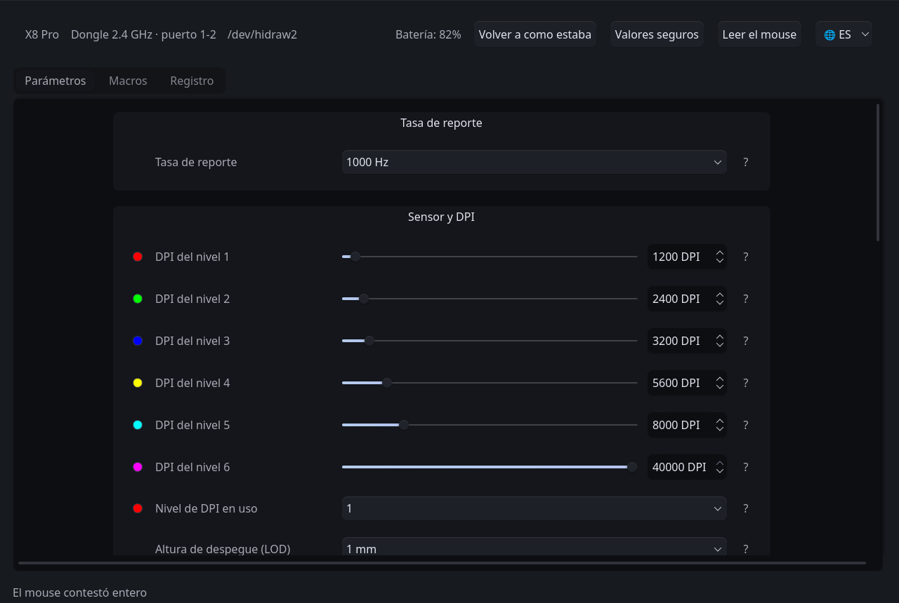

<p align="center"></p>

# LinShark

**Español** · [English](README.en.md) · [简体中文](README.zh-CN.md)

Suite de configuración nativa, controlador en espacio de usuario y documentación
de [ingeniería inversa][ing-inversa] para los ratones del ecosistema
**LXDDZ / Beken** —los que se configuran desde la plataforma web de
szslxd-tech.com, comercializados bajo las marcas Attack Shark, MambaSnake e
INX— en sistemas GNU/Linux.

Permite gestionar los parámetros del hardware ([resolución DPI][dpi], [tasa de
sondeo][polling], asignación de botones, secuencias de macros, temporizadores de
energía y registros del sensor) mediante una interfaz gráfica o herramientas de
línea de comandos, sin requerir el software propietario del fabricante ni el
servicio auxiliar que este exige.

Proyecto **independiente y no oficial** · [GPL-2.0-or-later](#licencia) ·
versión 0.1.0, sin *release* publicada.

> **Alcance actual:** hay **un modelo medido e integrado**, el **Attack Shark
> X8 Pro**. El catálogo del fabricante declara otros 46 que comparten *bundle* y
> protocolo, pero con ellos el programa no habla: ver
> [Modelos soportados](#modelos-soportados).



## Contenido

1. [Modelos soportados](#modelos-soportados)
2. [Qué configura](#qué-configura)
3. [Lo que deliberadamente no se ofrece](#lo-que-deliberadamente-no-se-ofrece)
4. [Instalación y uso](#instalación-y-uso)
5. [Estructura del repositorio](#estructura-del-repositorio)
6. [Cómo añadir un modelo](#cómo-añadir-un-modelo)
7. [Por qué un programa propio](#por-qué-un-programa-propio)
8. [Método y salvaguardas](#método-y-salvaguardas)
9. [Pruebas automatizadas](#pruebas-automatizadas)
10. [Documentación de referencia](#documentación-de-referencia)
11. [Licencia](#licencia), [aviso legal](#aviso-legal) y [glosario](#glosario)

---

## Modelos Soportados

| Modelo | Marca | USB (dongle / cable) | Estado | Perfil |
| :--- | :--- | :--- | :--- | :--- |
| **X8 Pro** | Attack Shark | `1d57:fa65` / `1d57:2126` | Medido e integrado, ambos caminos verificados contra el hardware | [`perfiles/x8pro.py`](driver/src/linshark/perfiles/x8pro.py) |

Los otros **46 modelos** del catálogo del fabricante —`X3Pro`, `X8SE`, `G3`,
`X11SE`, `X8Plus` y el resto, repartidos entre Attack Shark, MambaSnake e INX—
están identificados por nombre e identificador en
[`dispositivos.py`](driver/src/linshark/dispositivos.py), leídos del *bundle*
del fabricante, **pero ninguno se ha medido jamás**. Comparten aplicación web y
servicio auxiliar, así que es razonable esperar que el método sirva para ellos;
no es lo mismo que saber comunicarse con uno.

Si el modelo no aparece en la tabla, el programa no le habla. La vía para
añadirlo está en [Cómo añadir un modelo](#cómo-añadir-un-modelo).

---

## Qué Configura

Las capacidades que siguen son las del **Attack Shark X8 Pro**, el modelo
medido. Los rangos y los campos que se ofrecen los declara cada perfil, no el
código: en otro modelo serán los suyos.

- **Sensor y rendimiento:**
  - Ocho niveles de resolución en el bloque de DPI (seis cargados de fábrica en
    este modelo), de 100 a 40 000 [DPI][dpi] en pasos de 50, con selección del
    nivel activo.
  - Tasa de sondeo seleccionable entre las siete que declara el perfil (125 a
    8000 Hz) por enlace de 2.4 GHz; por cable el techo es de 1000 Hz, límite que
    impone el propio descriptor USB (*Full Speed*, `bInterval` de 1 ms). Cuatro
    de esas tasas están verificadas con el cronómetro del subsistema HID del
    kernel.
  - Registros del sensor: distancia de despegue (*Lift-Off Distance*, 1 mm o
    2 mm), control de fluctuación (*ripple control*), corrección de ángulo
    (*angle snapping*) y sincronización de movimiento (*motion sync*).
  - Tiempo de respuesta de los botones ([*debounce*][debounce]) de 4 a 50 ms, en
    pasos de 2.
- **Botones y macros:**
  - Reasignación de los 18 slots de botón, incluido el orden de la rueda, con la
    restricción del fabricante de conservar siempre un clic izquierdo asignado.
  - Atajos de teclado compuestos (modificadores más *usage* [HID][hid]) que el
    sistema operativo recibe como pulsaciones reales.
  - Grabación y escritura de listas de eventos de macro, con grabador en vivo en
    la interfaz gráfica.
- **Energía:**
  - Temporizador de reposo corto (0,5 a 30 min) e hibernación (1 a 60 min),
    independientes entre sí.
- **Conectividad y monitorización:**
  - Identificación del método de conexión (dongle de 2.4 GHz o cable) y del
    puerto físico leyendo únicamente [`sysfs`][sysfs], sin abrir el dispositivo ni
    emitirle nada.
  - Reconexión automática ante cambios [en caliente][hotplug] y aviso cuando el
    cable pasa a controlar el canal.
  - Lectura del estado de batería y de los avisos asíncronos que emite el propio
    firmware.
- **Interfaz:**
  - Aplicación PySide6 con tema propio o del entorno de escritorio, construida
    por completo a partir del modelo de datos: no conoce ningún campo por
    nombre.
  - Interfaz disponible en español, inglés y chino simplificado.

## Lo que Deliberadamente no se Ofrece

- **Control de color RGB en este modelo.** Los bytes se escriben, el dispositivo
  los acusa y la relectura los devuelve modificados, pero el chasis no enciende
  nada (MEDIDO). El control se retira por perfil
  (`dispositivos.Perfil.campos_ausentes`), no por código: en un modelo con RGB
  funcional reaparece sin tocar la interfaz.
- **Cambio del método de conexión (2.4 GHz o cable).** No existe tal comando en
  el *bundle* del fabricante, de modo que el cliente oficial tampoco puede
  hacerlo: se cambia con el botón físico del mouse.
- **Modo de iluminación, colores de indicador y activación de niveles de DPI.**
  Son constantes en las 76 escrituras capturadas del cliente oficial. Sin una
  captura que los modifique no existe Etapa 2 posible, y escribirlos equivaldría
  a inventar bytes.
- **El modo de despertado (cmd 7).** No puede leerse, y sin relectura no hay
  verificación posible.

---

## Instalación y Uso

### Requisitos

- Distribución GNU/Linux con [`udev`][udev] y subsistema [`hidraw`][hidraw].
- Python 3.10 o superior (lo comprueba el instalador).
- PySide6, solo para la interfaz gráfica. Si la distribución lo empaqueta, el
  instalador usa ese paquete; si no, lo obtiene mediante pip.
- El dongle de 2.4 GHz, o el mouse conectado por cable.

Se desarrolla y se mide en CachyOS con sesión Wayland. En otras distribuciones
y en X11 no se ha probado.

### Inicio rápido

```bash
sudo ./driver/instalar/install.sh          # instala en /opt/linshark y la regla de udev
linshark-gui                               # la aplicación
```

`--solo-probar` muestra lo que haría el instalador sin modificar nada, y
`sudo ./driver/instalar/uninstall.sh` lo revierte. La instalación deja
`linshark-gui` y `linshark` en `/usr/local/bin`, junto con una entrada en el
menú de aplicaciones; `linshark-gui --sin-tema` respeta el tema del entorno de
escritorio.

La aplicación **no lee el mouse al abrirse**: espera a que se lo pida el botón
«Leer el mouse».

> **Riesgo.** Este programa escribe en la memoria no volátil de un dispositivo
> físico. Las [salvaguardas](#método-y-salvaguardas) existen precisamente por
> eso, pero no anulan el riesgo: lo asume quien lo ejecuta.

**Por qué hace falta la regla de `udev`.** El canal de configuración es un nodo
`/dev/hidrawN` que por omisión solo puede abrir root. La regla le da acceso a
la sesión del usuario (`uaccess`) sobre la interfaz de configuración del mouse
y nada más, de modo que el programa no corre como root. Sin ella la aplicación
abre igual, avisa que faltan permisos y ofrece instalarla con un botón.

### Ejecución desde el repositorio

Con PySide6 disponible, y sin instalar nada:

```bash
sudo ./driver/scripts/instalar-udev.sh   # la regla de permisos, necesaria una vez
./driver/linshark-gui
```

### Línea de comandos

Cada escritura sigue el mismo ciclo que la interfaz: respaldo, confirmación,
escritura, relectura y comparación. Algunos ejemplos:

```bash
driver/scripts/donde-esta-el-mouse.py                 # diagnóstico del bus, no toca el dispositivo
driver/scripts/respaldar.py                           # respaldo completo del estado
driver/scripts/primera-escritura.py --comando dpi --nivel 1 --valor 1600
```

La lista completa de herramientas está en
[`driver/README.md`](driver/README.md#línea-de-comandos).

### El puente para la plataforma web

El proyecto nació como un servicio local que ocupa el lugar del auxiliar del
fabricante, para que la web oficial funcione en Linux. Se conserva en `driver/`
(`linshark --backend hidraw --mode read`) y lo verifica
`driver/tests/simula_pagina.py`, pero ya no es el objetivo: abrir esa página
reescribe todo lo que lee. Detalles en
[`driver/README.md`](driver/README.md#el-puente-para-la-plataforma-web).

### Incidencias conocidas

- **Con el cable enchufado a la PC, manda el cable**, aunque el selector del
  mouse diga 2.4 GHz, y la tasa de sondeo queda limitada a 1000 Hz.
- **Por encima de 1000 Hz el mouse no puede leerse entero.** La aplicación baja
  la tasa un momento para leer, lo anuncia en pantalla y la devuelve: es lo
  único que cambia sin que se le pida.
- **Cada escritura tarda varios segundos**, a propósito: se escribe, se relee y
  se compara, y el enlace de 2.4 GHz pierde peticiones con el mouse quieto.
- **Un macro de un solo evento no se reproduce**, y el firmware no suelta nada
  al terminar: una tecla trabada solo se libera desacoplando el dongle.
- **Abrir cualquiera de los clientes oficiales pisa configuración.** Después
  conviene leer el mouse y revisar.

Las causas, lo medido y qué hacer en cada caso están en
[`driver/README.md`](driver/README.md#incidencias).

---

## Estructura del Repositorio

El proyecto se divide en dos subsistemas desacoplados con responsabilidades
delimitadas:

| Componente | Descripción | Audiencia objetivo |
| :--- | :--- | :--- |
| **[`driver/`](driver/README.md)** | **Suite de usuario y controlador:** aplicación gráfica (PySide6), biblioteca del protocolo (`linshark`), herramientas CLI, puente para la web oficial, reglas de [`udev`][udev] e instalador. | Quien quiera configurar un modelo ya soportado. |
| **[`dev/`](dev/README.md)** | **Investigación e ingeniería inversa:** metodología de análisis, especificación del protocolo, matriz de evidencia, capturas USB ([`.pcap`][pcap]) e instrumental de medición. | Quien quiera auditar el protocolo o incorporar un modelo nuevo. |

> **Principio de aislamiento:** `driver/` es autosuficiente y puede distribuirse
> e instalarse de forma aislada. Las herramientas de `dev/` consumen la
> biblioteca de `driver/`, pero el controlador nunca depende de archivos de
> `dev/` en tiempo de ejecución. Lo verifica
> `driver/tests/salvaguardas.py::test_el_driver_no_necesita_a_dev`.

Dentro de cada subsistema, **todo lo que pertenece a un modelo concreto reside
en `models/<modelo>/`**: capturas, respaldos, mediciones y documentación de
protocolo en `dev/models/`; regla de `udev` y recursos asociados en
`driver/models/`. Lo transversal —el método, las herramientas, el mecanismo del
código— permanece en la raíz de cada subsistema.

`estructuras.py` no contiene desplazamientos de ningún modelo: los consulta al
perfil activo en cada llamada. Por eso incorporar un modelo consiste en añadir
un archivo a `driver/src/linshark/perfiles/` y sus carpetas en `dev/models/` y
`driver/models/`.

---

## Cómo Añadir un Modelo

El proyecto crece con capturas, no con código: la infraestructura ya es
multimodelo y lo que falta de cada dispositivo es la evidencia de cómo lo
configura su driver oficial. **Sin la captura del driver oficial no hay
protocolo.**

Hace falta el dispositivo, una VM de Windows con el software del fabricante y
tiempo: el X8 Pro llevó diez días, la mitad en obstáculos que ya están
resueltos. El procedimiento completo —identificar el dispositivo, obtener el
material del fabricante, capturar, decodificar, la primera escritura
verificada, el cable y el perfil— está en **[`dev/README.md`](dev/README.md)**,
con el criterio de aceptación de cada paso y la lista de lo que tiene que
quedar hecho. `test_el_perfil_manda_de_verdad`
comprueba que el código efectivamente consulta el perfil;
`test_el_perfil_no_miente` contrasta cada campo del X8 Pro contra sus capturas,
y un modelo nuevo le suma las comparaciones contra las suyas. Una línea de ese
test falla en cuanto aparece un perfil nuevo, de modo que un perfil copiado del
existente no pasa en silencio.

Las aportaciones que no requieren hardware también sirven: traducciones
(`linshark_ui/i18n.py`), empaquetado para distribuciones, y revisión de las
afirmaciones de
[`evidencia.md`](dev/models/attackshark-x8pro/docs/evidencia.md) —si algo está
clasificado como MEDIDO y no lo está, es un error que interesa conocer—.

---

## Por qué un Programa Propio

La plataforma de configuración del fabricante es una interfaz web que no emplea
la API estándar [WebHID][webhid]: delega la comunicación con el hardware en un
servicio auxiliar residente compilado exclusivamente para Windows y macOS. En
Linux la plataforma queda inoperativa al no detectar dicho servicio.

El proyecto comenzó implementando un [puente](#el-puente-para-la-plataforma-web)
compatible para habilitar esa interfaz web, pero el análisis del tráfico USB
determinó la necesidad de desarrollar una suite propia:

1. **Corrupción del estado durante la lectura.** En una captura de un único
   accionamiento del usuario, el cliente oficial leyó tres bloques y escribió
   cinco, **y los tres que había leído los reescribió alterados**: el control de
   fluctuación pasó de activo a inactivo, el reposo de 0,5 a 1 minuto, el tiempo
   de respuesta de 18 a 8, el color de verde a azul y la tasa de sondeo a un
   índice que ninguna captura previa mostraba. El cliente propietario no puede
   releer su propio estado sin degradarlo.
2. **Parámetros inaccesibles.** El software comercial no expone la totalidad de
   los registros que el firmware admite.
3. **Configuración sobreescrita.** La simple apertura de cualquiera de los dos
   clientes oficiales pisa configuración previa: la web reescribe todo lo que lee
   y deja invertido el desplazamiento de la rueda; el software nativo pisa el
   DPI, la corrección de ángulo y el tiempo de respuesta.

Cada afirmación anterior está respaldada por trazas reproducibles en
[`dev/models/attackshark-x8pro/docs/evidencia.md`](dev/models/attackshark-x8pro/docs/evidencia.md).

---

## Método y Salvaguardas

Los siete comandos que el dispositivo responde están decodificados. Los cinco
escribibles —tasa, DPI, iluminación y energía, botones y macros— se escriben con
verificación externa independiente (cronometrado del kernel, color del LED,
comportamiento físico del sensor, pulsaciones emitidas al sistema operativo),
tanto por el dongle de 2.4 GHz como por cable USB. Lo que sostiene eso:

1. **Prohibición de [*fuzzing*][fuzzing].** Cada trama procede de una captura
   del cliente oficial o del desensamblado de su binario auxiliar: un opcode
   inventado puede corresponder a una rutina del [gestor de
   arranque][bootloader] e inutilizar el dispositivo.
2. **Escritura en cuatro etapas:** respaldo íntegro, captura del driver oficial,
   reproducción del bloque byte a byte sin emitir nada, y solo entonces
   escritura de un campo, relectura y comparación.
3. **Cuatro controles independientes sobre las lecturas** —[checksum][checksum]
   interno, [canario][canario] sobre registros inmutables, contraste cruzado
   contra el perfil completo y reconocimiento del bloque anterior—, porque el
   dispositivo tiene un único búfer para todos los reportes y a veces devuelve
   el de la consulta anterior. Una lectura que no los supera no alcanza jamás a
   un codificador.
4. **Validación de rango antes de emitir:** el bloque se juzga inmediatamente
   antes de escribirlo, no después de leerlo.
5. **Clasificación epistemológica:** toda afirmación técnica se etiqueta como
   **[MEDIDO, LEÍDO o INFERIDO][clasificacion]**, en la documentación y en el
   código.
6. **Supervisión humana:** los ensayos contra el dispositivo los ejecuta una
   persona, porque la medición se contamina si alguien usa el mouse durante una
   corrida.

El detalle de cada punto, con las señales de alarma, está en
[`dev/docs/metodo.md`](dev/docs/metodo.md).

---

## Pruebas Automatizadas

La batería completa se ejecuta **sin el dispositivo físico**:

```bash
python3 driver/tests/salvaguardas.py                   # protocolo, perfiles y salvaguardas
python3 driver/tests/simula_pagina.py                  # el puente, contra la web oficial
QT_QPA_PLATFORM=offscreen python3 driver/tests/interfaz.py   # la interfaz, sin ventana
python3 dev/tests/evidencia.py                         # las afirmaciones, contra los respaldos
```

---

## Documentación de Referencia

- **[Guía del driver y las herramientas](driver/README.md)** — manual de la
  aplicación, del CLI y de las incidencias conocidas.
- **[Guía de ingeniería inversa](dev/README.md)** — procedimiento para capturar,
  analizar e incorporar un modelo.
- **[Metodología](dev/docs/metodo.md)** — las cuatro etapas, las salvaguardas y
  las señales de alarma.
- **[Matriz de evidencia](dev/models/attackshark-x8pro/docs/evidencia.md)** — qué
  se sabe y cómo se sabe, clasificado.
- **[Especificación del protocolo](dev/models/attackshark-x8pro/docs/protocolo.md)**
  — estructura de tramas, bloques y códigos de operación.
- **[Bitácora de ensayos](dev/models/attackshark-x8pro/docs/bitacora.md)** —
  registro cronológico, incluido lo que no funcionó.
- **[Descriptores USB/HID](dev/models/attackshark-x8pro/docs/hardware.md)** — el
  hardware visto desde Linux, por dongle y por cable.

---

## Licencia

**GPL-2.0-or-later**: la GNU GPL versión 2 o, a elección de quien la reciba,
cualquier versión posterior. [`LICENSE`](LICENSE) contiene el texto de la
versión 2 tal como lo publica la FSF, sin modificar; el «o posterior» lo declara
el identificador SPDX que lleva cada archivo de código.

En términos prácticos: se puede usar, estudiar, modificar y redistribuir, y todo
trabajo derivado que se distribuya debe publicarse bajo los mismos términos.

Las dependencias son compatibles y se han verificado una por una: **PySide6** y
**shiboken6** se ofrecen bajo `LGPL-3.0-only OR GPL-2.0-only OR GPL-3.0-only`,
de modo que pueden tomarse por la rama GPLv2; **websockets** y **evdev** son
BSD-3-Clause. Ninguna se redistribuye con este proyecto: el instalador las
obtiene en el equipo del usuario.

## Aviso legal

Proyecto **independiente y no oficial**. No está afiliado, patrocinado ni
respaldado por Guangzhou Junxingcheng Electronic Technology, LXDDZ, Beken,
Attack Shark, MambaSnake, INX ni ninguna otra marca mencionada. Los nombres
comerciales y las marcas registradas pertenecen a sus respectivos titulares y se
emplean exclusivamente para identificar el hardware con el que este software es
compatible.

El protocolo se ha documentado mediante **ingeniería inversa con fines de
interoperabilidad**: hacer funcionar en GNU/Linux un dispositivo adquirido
legítimamente, para el que el fabricante no ofrece soporte en ese sistema. No se
redistribuye software del fabricante: de su aplicación web y de su servicio
auxiliar se conservan **únicamente huellas criptográficas**, para que cualquiera
pueda obtener por su cuenta exactamente el mismo material y comprobar las citas
de la documentación.

Este software se ofrece **sin garantía de ningún tipo**, tal como establecen las
secciones 11 y 12 de la GPL. Escribe en la memoria no volátil de un dispositivo
físico; las salvaguardas descritas más arriba existen precisamente por eso, pero
el riesgo lo asume quien lo ejecuta.

---

## Glosario

Los términos de la industria enlazan a su definición general; los propios del
proyecto, al lugar del repositorio donde viven.

| Término | Qué significa aquí | Dónde vive |
| :--- | :--- | :--- |
| [Canario][canario] | Un valor que no debería cambiar nunca y que se vigila para detectar que algo se corrompió. Aquí es la versión de firmware: no se puede escribir, de modo que si una relectura la devuelve alterada, lo que está mal es la lectura. La expresión procede del canario que los mineros bajaban a la mina de carbón. | `sesion.juzgar()`, `CMDS_INMUTABLES` |
| Sangrado de búfer | El dispositivo dispone de un único búfer para todos los reportes, de modo que una consulta puede devolver el contenido de la anterior con la cabecera correcta. Medido en el 1 a 2,5 % de las peticiones por cable. | `Cable._es_el_bloque_anterior()` |
| [Checksum][checksum] | Suma de verificación. Aquí hay dos: uno de trama y otro interno al bloque, y el interno se calcula sobre un rango que no es evidente. | `protocol.py` |
| Etapas 0 a 3 | La metodología de escritura del proyecto: respaldar, capturar al driver oficial, reproducir sus bytes sin emitir nada, y solo entonces escribir un campo y releer. | [`dev/docs/metodo.md`](dev/docs/metodo.md) |
| [MEDIDO, LEÍDO, INFERIDO][clasificacion] | La clasificación obligatoria de toda afirmación técnica: observado contra el hardware, leído en el binario del fabricante, o deducido —y por tanto posiblemente falso—. | [`evidencia.md`](dev/models/attackshark-x8pro/docs/evidencia.md) |
| Perfil | La declaración de un modelo concreto: identificadores USB, tamaños de bloque, número de botones, rangos. El código lo consulta en cada llamada y no conoce ningún modelo por nombre. | `dispositivos.Perfil`, `perfiles/` |
| Tasa prestada | Por encima de 1000 Hz el dispositivo no puede leerse entero, así que la aplicación baja la tasa temporalmente para poder respaldar, lo anuncia en pantalla y la restituye. Es lo único que modifica sin que se le pida. | [`driver/README.md`](driver/README.md#la-tasa-prestada) |
| [Fuzzing][fuzzing] | Emitir entradas arbitrarias para ver cómo reacciona un sistema. Prohibido aquí: un opcode inventado puede caer en el [gestor de arranque][bootloader]. | — |
| [hidraw][hidraw] | La interfaz del kernel de Linux que permite hablar con un dispositivo [HID][hid] en crudo, sin que un controlador interprete los reportes. | `/dev/hidrawN` |
| [udev][udev] | El gestor de dispositivos de Linux. Su regla es lo que concede acceso al canal de configuración sin privilegios de root. | `driver/models/<modelo>/udev/` |
| [Polling rate][polling] | Cuántas veces por segundo el dispositivo informa de su posición. Aquí, «tasa de sondeo» o «tasa de reporte». | `cmd 6`, `medir-polling.py` |

[ing-inversa]: https://es.wikipedia.org/wiki/Ingenier%C3%ADa_inversa
[dpi]: https://es.wikipedia.org/wiki/Puntos_por_pulgada
[polling]: https://en.wikipedia.org/wiki/Polling_(computer_science)
[udev]: https://es.wikipedia.org/wiki/Udev
[hidraw]: https://www.kernel.org/doc/html/latest/hid/hidraw.html
[hid]: https://es.wikipedia.org/wiki/Dispositivo_de_interfaz_humana
[webhid]: https://developer.mozilla.org/en-US/docs/Web/API/WebHID_API
[fuzzing]: https://es.wikipedia.org/wiki/Fuzzing
[bootloader]: https://es.wikipedia.org/wiki/Cargador_de_arranque
[checksum]: https://es.wikipedia.org/wiki/Suma_de_verificaci%C3%B3n
[canario]: https://en.wikipedia.org/wiki/Buffer_overflow_protection#Canaries
[sysfs]: https://es.wikipedia.org/wiki/Sysfs
[pcap]: https://es.wikipedia.org/wiki/Pcap
[hotplug]: https://es.wikipedia.org/wiki/Conexi%C3%B3n_en_caliente
[debounce]: https://en.wikipedia.org/wiki/Switch#Contact_bounce
[clasificacion]: dev/models/attackshark-x8pro/docs/evidencia.md
