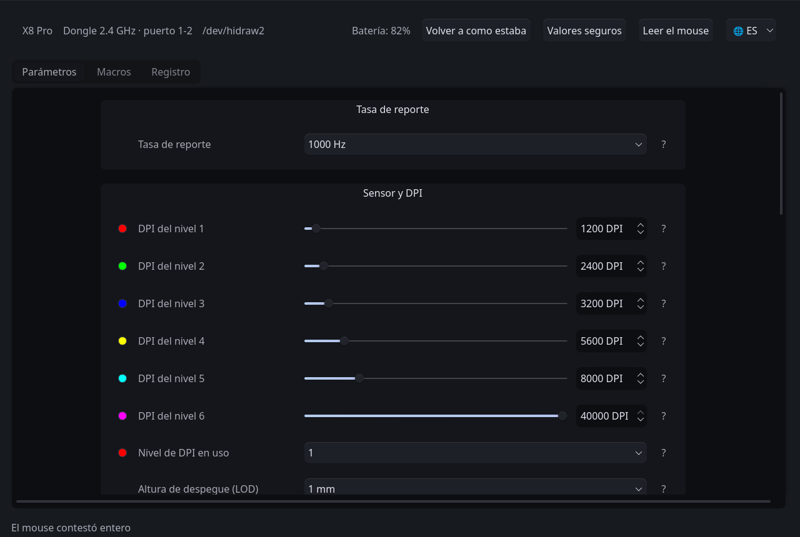

<!-- traduce: README.md sha256:90b16d4af088e89a44aca46b4c2f816ed6e4e13f5ffa7df3fa8b4461f9d5488d -->
<p align="center"></p>

# LinShark

[Español](README.md) · [English](README.en.md) · **简体中文**

> 本文是译文。原文是西班牙语的 [`README.md`](README.md)，西班牙语是本项目的工作语言：
> 两者不一致时，以西班牙语原文为准。

面向 GNU/Linux 的 **LXDDZ / Beken** 生态鼠标（即通过 szslxd-tech.com 网页平台配置、以
Attack Shark、MambaSnake 和 INX 品牌销售的鼠标）的原生配置套件、用户空间驱动，以及
[逆向工程][reverse]文档。

它通过图形界面或命令行工具管理硬件参数（[DPI 分辨率][dpi]、[回报率][polling]、按键
分配、宏序列、电源计时器和传感器寄存器），不需要厂商的专有软件，也不需要该软件所依赖
的辅助服务。

**独立的非官方**项目 · [GPL-2.0-or-later](#许可证) · 版本 0.1.0，尚未发布正式版本。

> **当前范围**：只有**一个经过实测并已集成的型号**，即 **Attack Shark X8 Pro**。
> 厂商的产品目录还声明了另外 46 个共用同一 *bundle*（网页前端打包文件）和同一协议的
> 型号，但本程序不与它们通信：见[支持的型号](#支持的型号)。



## 目录

1. [支持的型号](#支持的型号)
2. [可以配置什么](#可以配置什么)
3. [刻意不提供的功能](#刻意不提供的功能)
4. [安装与使用](#安装与使用)
5. [仓库结构](#仓库结构)
6. [如何添加一个型号](#如何添加一个型号)
7. [为什么要自己写一个程序](#为什么要自己写一个程序)
8. [方法与安全措施](#方法与安全措施)
9. [自动化测试](#自动化测试)
10. [参考文档](#参考文档)
11. [许可证](#许可证)、[法律声明](#法律声明)和[术语表](#术语表)

---

## 支持的型号

| 型号 | 品牌 | USB（接收器 / 有线） | 状态 | 配置档案 |
| :--- | :--- | :--- | :--- | :--- |
| **X8 Pro** | Attack Shark | `1d57:fa65` / `1d57:2126` | 已实测并集成，两种连接方式都已对照硬件验证 | [`perfiles/x8pro.py`](driver/src/linshark/perfiles/x8pro.py) |

厂商目录中的其余 **46 个型号**（`X3Pro`、`X8SE`、`G3`、`X11SE`、`X8Plus` 等，分属
Attack Shark、MambaSnake 和 INX）已在 [`dispositivos.py`](driver/src/linshark/dispositivos.py)
中按名称和 ID 列出，这些信息读取自厂商的 *bundle*，**但其中没有一个被实测过**。它们共用
同一个网页应用和辅助服务，因此可以合理地期待本方法对它们同样适用；但这并不等于知道如何
与其中任何一个通信。

表中没有的型号，本程序不会与之通信。添加的方法见[如何添加一个型号](#如何添加一个型号)。

---

## 可以配置什么

以下功能属于 **Attack Shark X8 Pro**，即已实测的型号。可用的范围和字段由各型号的配置
档案声明，而不是写在代码里：换一个型号，就是那个型号自己的范围和字段。

- **传感器与性能：**
  - DPI 数据块中有八个分辨率档位（本型号出厂时加载了六个），范围 100 至 40 000
    [DPI][dpi]，步进 50，并可选择当前档位。
  - 回报率可在配置档案声明的七档中选择（125 至 8000 Hz），通过 2.4 GHz 无线连接；
    有线连接时上限为 1000 Hz，这是 USB 描述符本身的限制（*Full Speed*，`bInterval`
    为 1 ms）。其中四档已用内核 HID 子系统的计时验证。
  - 传感器寄存器：静默高度（LOD，1 mm 或 2 mm）、波纹控制、直线修正和动作同步。
  - 按键响应时间（[*debounce*][debounce]，去抖动）4 至 50 ms，步进 2。
- **按键与宏：**
  - 重新分配 18 个按键槽位，包括滚轮的顺序；遵循厂商的限制，始终保留一个左键。
  - 组合键盘快捷键（修饰键加一个 [HID][hid] *usage*），操作系统会把它当作真实按键接收。
  - 录制并写入宏事件列表，图形界面中带有实时录制器。
- **电源：**
  - 浅度休眠计时器（0.5 至 30 分钟）和深度休眠（1 至 60 分钟），两者互相独立。
- **连接与监控：**
  - 只读取 [`sysfs`][sysfs] 来识别连接方式（2.4 GHz 接收器或有线）和物理端口，不打开
    设备，也不向它发送任何数据。
  - [热插拔][hotplug]时自动重新连接，并在有线连接接管通道时发出提示。
  - 读取电池状态，以及固件自己发出的异步通知。
- **界面：**
  - PySide6 应用，可使用自带主题或桌面主题；完全由数据模型生成：它不按名称认识任何
    字段。
  - 界面提供西班牙语、英语和简体中文。

## 刻意不提供的功能

- **本型号的 RGB 颜色控制**。字节会被写入，设备会确认，回读也显示已改变，但机身不会
  亮起任何灯光（MEDIDO：已实测）。该控件是通过配置档案去掉的
  （`dispositivos.Perfil.campos_ausentes`），而不是写死在代码里：在 RGB 真正可用的
  型号上，它会重新出现，无需修改界面。
- **切换连接方式（2.4 GHz 或有线）**。厂商的 *bundle* 中没有这样的命令，所以官方
  客户端也做不到：需要用鼠标上的物理按键切换。
- **灯光模式、指示灯颜色和 DPI 档位的启用状态**。在官方客户端被捕获的 76 次写入中，
  它们始终不变。没有一次改变它们的捕获，就不可能完成第 2 阶段；写入它们等于凭空编造
  字节。
- **唤醒模式（cmd 7）**。它无法被读取，而没有回读就无法验证。

---

## 安装与使用

### 系统要求

- 带有 [`udev`][udev] 和 [`hidraw`][hidraw] 子系统的 GNU/Linux 发行版。
- Python 3.10 或更高版本（安装程序会检查）。
- PySide6，仅图形界面需要。如果发行版提供该软件包，安装程序会使用它；否则通过 pip
  获取。
- 2.4 GHz 接收器，或用线缆连接的鼠标。

本项目在 CachyOS 的 Wayland 会话下开发和测量。尚未在其他发行版或 X11 上测试。

### 快速开始

```bash
sudo ./driver/instalar/install.sh          # 安装到 /opt/linshark，并安装 udev 规则
linshark-gui                               # 应用程序
```

`--solo-probar` 会显示安装程序将要做的事而不做任何修改，`sudo ./driver/instalar/uninstall.sh`
则撤销安装。安装后 `/usr/local/bin` 中会有 `linshark-gui` 和 `linshark`，应用菜单中也会
有一个条目；`linshark-gui --sin-tema` 使用桌面主题。

应用程序**打开时不会读取鼠标**：它会等你点击 **读取鼠标** 按钮。

窗口已翻译；命令行工具及其输出信息为西班牙语。

> **风险**。本程序会写入物理设备的非易失性存储器。[安全措施](#方法与安全措施)正是
> 为此而设，但它们不能消除风险：风险由运行者自行承担。

**为什么需要 `udev` 规则**。配置通道是一个 `/dev/hidrawN` 节点，默认只有 root 能打开。
该规则让用户会话（`uaccess`）可以访问鼠标的配置接口，且仅限于此，因此程序无需以 root
身份运行。没有这条规则时，应用照样能打开，会提示缺少权限，并提供一个按钮来安装它。

### 从仓库直接运行

在已有 PySide6 的情况下，无需安装任何东西：

```bash
sudo ./driver/scripts/instalar-udev.sh   # 权限规则，只需一次
./driver/linshark-gui
```

### 命令行

每次写入都遵循与界面相同的流程：备份、确认、写入、回读和比较。几个例子：

```bash
driver/scripts/donde-esta-el-mouse.py                 # 诊断总线，不接触设备
driver/scripts/respaldar.py                           # 完整备份当前状态
driver/scripts/primera-escritura.py --comando dpi --nivel 1 --valor 1600
```

完整的工具列表见 [`driver/README.zh-CN.md`](driver/README.zh-CN.md#命令行)。

### 网页平台桥接

本项目最初是一个本地服务，用来顶替厂商的辅助服务，让官方网页能在 Linux 上工作。它仍保留
在 `driver/` 中（`linshark --backend hidraw --mode read`），并由 `driver/tests/simula_pagina.py`
验证，但它已不再是目标：打开那个网页会重写它读到的一切。详见
[`driver/README.zh-CN.md`](driver/README.zh-CN.md#网页平台桥接)。

### 已知问题

- **线缆插在电脑上时，由线缆接管**，即使鼠标的开关显示 2.4 GHz，此时回报率被限制在
  1000 Hz。
- **高于 1000 Hz 时无法完整读取鼠标**。应用会暂时降低回报率以便读取，在屏幕上说明，
  之后再恢复：这是它唯一会在未经要求时改变的东西。
- **每次写入需要几秒钟**，这是有意的：写入、回读、比较；而且鼠标静止时 2.4 GHz 连接
  会丢失请求。
- **只有一个事件的宏不会执行**，并且宏结束时固件不会释放任何按键：被卡住的按键只能
  通过拔下接收器来释放。
- **打开任何一个官方客户端都会覆盖设置**。之后应读取鼠标并检查。

各项的原因、实测结果和处理方法见
[`driver/README.zh-CN.md`](driver/README.zh-CN.md#已知问题)。

---

## 仓库结构

本项目分为两个解耦、职责明确的子系统：

| 组件 | 说明 | 面向的读者 |
| :--- | :--- | :--- |
| **[`driver/`](driver/README.zh-CN.md)** | **用户套件与驱动**：图形应用（PySide6）、协议库（`linshark`）、命令行工具、官方网页的桥接、[`udev`][udev] 规则和安装程序。 | 想要配置已支持型号的人。 |
| **[`dev/`](dev/README.md)**（西班牙语） | **研究与逆向工程**：分析方法、协议规范、证据矩阵、USB 捕获（[`.pcap`][pcap]）和测量工具。 | 想要审查协议或添加新型号的人。 |

**`dev/` 只有西班牙语，这是有意的**。那里是操作流程和证据：如果那里的译文落后于原文，
就可能有人按照理解错误的第 2 阶段向鼠标写入数据。添加型号的人请阅读原文。

> **隔离原则**：`driver/` 是自给自足的，可以单独分发和安装。`dev/` 中的工具使用
> `driver/` 的库，但驱动在运行时从不依赖 `dev/` 中的文件。由
> `driver/tests/salvaguardas.py::test_el_driver_no_necesita_a_dev` 检查。

在每个子系统中，**属于某个具体型号的一切都放在 `models/<型号>/` 下**：捕获、备份、测量
结果和协议文档在 `dev/models/`；`udev` 规则及相关资源在 `driver/models/`。通用的部分
（方法、工具、代码机制）留在各子系统的根目录。

`estructuras.py` 不包含任何型号的偏移量：它在每次调用时向当前配置档案查询。因此添加一个
型号就是在 `driver/src/linshark/perfiles/` 中添加一个文件，并在 `dev/models/` 和
`driver/models/` 中建立它的文件夹。

---

## 如何添加一个型号

本项目靠捕获数据成长，而不是靠代码：基础设施已经支持多型号，每个设备缺少的是其官方驱动
如何配置它的证据。**没有官方驱动的捕获，就没有协议。**

需要设备本身、一台装有厂商软件的 Windows 虚拟机，以及时间：X8 Pro 花了十天，其中一半
耗费在如今已经解决的障碍上。完整流程（识别设备、获取厂商资料、捕获、解码、第一次经过
验证的写入、有线连接和配置档案）见 **[`dev/README.md`](dev/README.md)**（西班牙语），
其中包括每一步的验收标准以及必须完成的事项清单。`test_el_perfil_manda_de_verdad` 检查
代码确实在查询配置档案；`test_el_perfil_no_miente` 将 X8 Pro 的每个字段与其捕获数据
对照，新型号需要加入与自己捕获数据的对照。该测试中有一行会在出现新配置档案时立即失败，
因此照抄现有配置档案的做法不会悄无声息地通过。

不需要硬件的贡献同样有用：翻译（`linshark_ui/i18n.py`）、为发行版打包，以及审查
[`evidencia.md`](dev/models/attackshark-x8pro/docs/evidencia.md) 中的论断：如果某项被
标为 MEDIDO（已实测）而实际上并非如此，那是一个值得知道的错误。

---

## 为什么要自己写一个程序

厂商的配置平台是一个网页界面，它不使用标准的 [WebHID][webhid] API，而是把与硬件的通信
交给一个常驻的辅助服务，而该服务只为 Windows 和 macOS 编译。在 Linux 上，平台找不到
这个服务，因此无法使用。

本项目最初实现了一个兼容的[桥接](#网页平台桥接)来启用这个网页界面，但对 USB 通信的
分析表明，需要开发一个自己的套件：

1. **读取过程中状态被破坏**。在一次只包含用户单个操作的捕获中，官方客户端读取了三个
   数据块、写入了五个，**并且把读到的那三个改动后写了回去**：波纹控制从开变成关，浅度
   休眠从 0.5 分钟变成 1 分钟，响应时间从 18 变成 8，颜色从绿色变成蓝色，回报率变成了
   以往任何捕获中都没有出现过的索引。这个专有客户端无法在不破坏自身状态的前提下回读它。
2. **无法访问的参数**。商业软件没有开放固件支持的全部寄存器。
3. **设置被覆盖**。只要打开两个官方客户端中的任何一个，就会覆盖之前的设置：网页会重写它
   读到的一切，并把滚轮方向反转；原生软件会覆盖 DPI、直线修正和响应时间。

以上每一条都有可复现的记录作为依据，见
[`dev/models/attackshark-x8pro/docs/evidencia.md`](dev/models/attackshark-x8pro/docs/evidencia.md)
（西班牙语）。

---

## 方法与安全措施

设备响应的七个命令都已解码。五个可写的命令（回报率、DPI、灯光与电源、按键和宏）的写入
都经过独立的外部验证（内核计时、LED 颜色、传感器的实际表现、发送给操作系统的按键），
无论是通过 2.4 GHz 接收器还是 USB 线缆。支撑这一点的是：

1. **禁止[模糊测试][fuzzing]**。每一帧都来自对官方客户端的捕获，或来自其辅助程序的
   反汇编：一个编造的操作码可能落到[引导程序][bootloader]的某个例程上，使设备变砖。
2. **分四个阶段写入**：完整备份、捕获官方驱动、在不发送任何数据的情况下逐字节复现
   数据块，只有这之后才写入一个字段、回读并比较。
3. **对读取的四项独立检查**：内部[校验和][checksum]、针对不可变寄存器的[金丝雀值][canary]、
   与完整配置的交叉核对，以及识别上一个数据块。之所以需要它们，是因为设备所有报告共用
   一个缓冲区，有时会返回上一次请求的内容。未通过检查的读取永远不会到达编码器。
4. **发送前的范围校验**：数据块在即将写入之前受检，而不是在读取之后。
5. **认识论分类**：每一条技术论断都标注为 **[MEDIDO、LEÍDO 或 INFERIDO][classification]**
   （已实测、读自厂商二进制、推断），在文档和代码中都是如此。这些标签保留西班牙语，因为
   它们所指向的文档中就是这样写的。
6. **人工监督**：针对设备的测试由人来运行，因为如果有人在运行期间使用鼠标，测量就会被
   污染。

每一点的细节以及警示信号见 [`dev/docs/metodo.md`](dev/docs/metodo.md)（西班牙语）。

---

## 自动化测试

整套测试**无需实体设备**即可运行：

```bash
python3 driver/tests/salvaguardas.py                   # 协议、配置档案和安全措施
python3 driver/tests/simula_pagina.py                  # 桥接，对照官方网页
QT_QPA_PLATFORM=offscreen python3 driver/tests/interfaz.py   # 界面，无窗口
python3 dev/tests/evidencia.py                         # 各项论断，对照备份
```

---

## 参考文档

- **[驱动与工具指南](driver/README.zh-CN.md)**：应用、命令行和已知问题的手册。

以下仅有西班牙语：

- **[逆向工程指南](dev/README.md)**：捕获、分析和添加型号的流程。
- **[方法论](dev/docs/metodo.md)**：四个阶段、安全措施和警示信号。
- **[证据矩阵](dev/models/attackshark-x8pro/docs/evidencia.md)**：知道什么、如何知道，
  并已分类。
- **[协议规范](dev/models/attackshark-x8pro/docs/protocolo.md)**：帧、数据块和操作码的
  结构。
- **[测试日志](dev/models/attackshark-x8pro/docs/bitacora.md)**：按时间顺序的记录，包括
  没有成功的尝试。
- **[USB/HID 描述符](dev/models/attackshark-x8pro/docs/hardware.md)**：从 Linux 看到的
  硬件，分别通过接收器和线缆。

---

## 许可证

**GPL-2.0-or-later**：GNU GPL 第 2 版，或由接收者选择的任何更高版本。
[`LICENSE`](LICENSE) 包含 FSF 发布的第 2 版原文，未作修改；“或更高版本”由每个代码文件
携带的 SPDX 标识声明。

实际上：可以使用、研究、修改和再分发，任何被分发的衍生作品都必须以相同条款发布。

依赖项都是兼容的，并已逐一核实：**PySide6** 和 **shiboken6** 采用
`LGPL-3.0-only OR GPL-2.0-only OR GPL-3.0-only`，因此可以按 GPLv2 分支使用；
**websockets** 和 **evdev** 为 BSD-3-Clause。本项目不随附其中任何一个：安装程序会在
用户的机器上获取它们。

## 法律声明

**独立的非官方**项目。与 Guangzhou Junxingcheng Electronic Technology、LXDDZ、Beken、
Attack Shark、MambaSnake、INX 或文中提到的任何其他品牌均无隶属、赞助或认可关系。商品名称
和注册商标归各自所有者所有，仅用于标识本软件所兼容的硬件。

该通信协议是通过**以互操作为目的的逆向工程**记录下来的：让一台合法购得、而厂商在该系统上
不提供支持的设备能在 GNU/Linux 上工作。本项目不分发厂商的任何软件：对于其网页应用和
辅助服务，**只保留加密指纹**，以便任何人都能自行获取完全相同的资料，并核对文档中的
引用。

本软件**不提供任何形式的担保**，如 GPL 第 11 和第 12 条所述。它会写入物理设备的非易失性
存储器；上文所述的安全措施正是为此而设，但风险由运行者自行承担。

---

## 术语表

行业术语链接到其通用定义；本项目自有的术语链接到它在仓库中的位置。项目在代码或文档中
使用西班牙语名称的，在括号中注明。

| 术语 | 在这里的含义 | 位置 |
| :--- | :--- | :--- |
| [金丝雀值][canary]（*canario*） | 一个永远不应改变、被监视着用来发现数据损坏的值。这里是固件版本：它无法被写入，所以如果回读时它变了，出错的是这次读取。这个说法来自矿工带进煤矿的金丝雀。 | `sesion.juzgar()`、`CMDS_INMUTABLES` |
| 缓冲区串读（*sangrado de búfer*） | 设备所有报告共用一个缓冲区，因此一次请求可能以正确的报头返回上一次请求的内容。实测在有线连接的 1% 至 2.5% 的请求中出现。 | `Cable._es_el_bloque_anterior()` |
| [校验和][checksum] | 这里有两个：一个属于帧，一个位于数据块内部，而内部校验和的计算范围并不显而易见。 | `protocol.py` |
| 第 0 至第 3 阶段（*Etapas*） | 本项目的写入方法：备份、捕获官方驱动、在不发送任何数据的情况下复现其字节，只有这之后才写入一个字段并回读。 | [`dev/docs/metodo.md`](dev/docs/metodo.md)（西班牙语） |
| [MEDIDO、LEÍDO、INFERIDO][classification] | 每一条技术论断必须具备的分类：对照硬件观察到的（已实测）、在厂商二进制中读到的（已读取），或推断出的，因而可能是错的（推断）。 | [`evidencia.md`](dev/models/attackshark-x8pro/docs/evidencia.md)（西班牙语） |
| 配置档案（*perfil*） | 对一个具体型号的声明：USB ID、数据块大小、按键数量、范围。代码在每次调用时查询它，不按名称认识任何型号。 | `dispositivos.Perfil`、`perfiles/` |
| 临时借用的回报率（*tasa prestada*） | 高于 1000 Hz 时无法完整读取设备，因此应用会暂时降低回报率以便备份，在屏幕上说明，之后再恢复。这是它唯一会在未经要求时改变的东西。 | [`driver/README.zh-CN.md`](driver/README.zh-CN.md#临时借用的回报率) |
| [模糊测试][fuzzing]（fuzzing） | 发送任意输入，观察系统的反应。这里是禁止的：一个编造的操作码可能落到[引导程序][bootloader]上。 | — |
| [hidraw][hidraw] | Linux 内核提供的接口，用于以原始方式与 [HID][hid] 设备通信，不经驱动解释报告。 | `/dev/hidrawN` |
| [udev][udev] | Linux 的设备管理器。它的规则使无需 root 权限即可访问配置通道。 | `driver/models/<型号>/udev/` |
| [回报率][polling]（polling rate） | 设备每秒报告其位置的次数。 | `cmd 6`、`medir-polling.py` |

[reverse]: https://en.wikipedia.org/wiki/Reverse_engineering
[dpi]: https://en.wikipedia.org/wiki/Dots_per_inch
[polling]: https://en.wikipedia.org/wiki/Polling_(computer_science)
[udev]: https://en.wikipedia.org/wiki/Udev
[hidraw]: https://www.kernel.org/doc/html/latest/hid/hidraw.html
[hid]: https://en.wikipedia.org/wiki/Human_interface_device
[webhid]: https://developer.mozilla.org/en-US/docs/Web/API/WebHID_API
[fuzzing]: https://en.wikipedia.org/wiki/Fuzzing
[bootloader]: https://en.wikipedia.org/wiki/Bootloader
[checksum]: https://en.wikipedia.org/wiki/Checksum
[canary]: https://en.wikipedia.org/wiki/Buffer_overflow_protection#Canaries
[sysfs]: https://en.wikipedia.org/wiki/Sysfs
[pcap]: https://en.wikipedia.org/wiki/Pcap
[hotplug]: https://en.wikipedia.org/wiki/Hot_swapping
[debounce]: https://en.wikipedia.org/wiki/Switch#Contact_bounce
[classification]: dev/models/attackshark-x8pro/docs/evidencia.md
