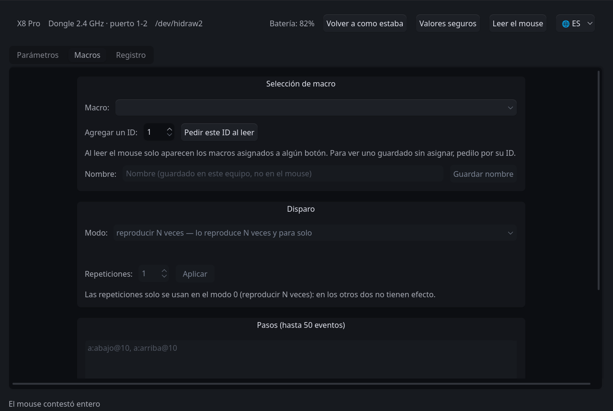

<!-- traduce: README.md sha256:47bdc3a422dcadc6f3066e4c2b6a35492b628a5d147b4d58073a5ad247a39390 -->
<p align="center"></p>

# LinShark — configuration suite for Linux

[Español](README.md) · **English** · [简体中文](README.zh-CN.md)

> This is a translation. The original is [`README.md`](README.md), in Spanish,
> the language of the project: if the two disagree, the Spanish one is right.

Configures the mouse **without the official client**: DPI, polling rate,
buttons, macros, power timers and sensor registers, from a graphical interface
or from the terminal. It does not need Windows, nor the manufacturer's web
platform, nor the helper service that platform requires and that only exists
for Windows and macOS.

```
sudo ./instalar/install.sh      # once
linshark-gui                    # the application
```

**Where this file is read.** In the repository it is `driver/README.md`, and
the installer copies it to `/opt/linshark/README.md`, together with its
translations. The relative paths that appear —`./instalar/`, `scripts/`— are
relative to that directory, whichever of the two it is.

The program talks to the model whose profile is loaded. Today there is **one
measured** model —checked against the mouse, not deduced—: the Attack Shark
X8 Pro. A model that was not measured does not exist for the program; the
procedure to add another is in the `dev/` directory of the full repository,
only in Spanish, on purpose: it is procedure and evidence, and a translation
that falls behind there means someone writing to the mouse after
misunderstanding a step.

The window is translated; the command-line tools and their messages are in
Spanish.

---

## What Can Be Changed on the X8 Pro

The ranges are declared by the model's profile; these are the X8 Pro's.

| Parameter | Values |
| :--- | :--- |
| Resolution | eight levels (six loaded from the factory), from 100 to 40 000 DPI in steps of 50, and which one is in use |
| Polling rate | 125, 250, 500, 1000, 2000, 4000 and 8000 Hz over the dongle; up to 1000 Hz over the cable |
| Sensor | lift-off distance (1 or 2 mm), ripple control, angle snapping, motion sync |
| Button response time | 4 to 50 ms, in steps of 2 |
| Buttons | 18 slots, including the order of the scroll wheel; a left click always stays on buttons 1 to 5 |
| Keyboard shortcuts | modifiers plus a key, assigned to a button |
| Macros | up to 50 events per macro, with a recorder in the window |
| Power | short sleep from 0.5 to 30 min; deep sleep from 1 to 60 min |

What is not in the table is not offered, on purpose: see
[What this program does not do](#what-this-program-does-not-do).

---

## Requirements

- **Linux** with `udev` and Python 3.10 or later.
- **PySide6** for the graphical interface. If the distribution packages it
  (`python-pyside6`, `python3-pyside6`), the installer uses that package;
  otherwise it gets it through pip.
- The **2.4 GHz dongle**, or the mouse connected **by cable**. Over the cable
  the polling rate does not go above 1000 Hz (see [Known issues](#known-issues)).

## Installation

```bash
sudo ./instalar/install.sh
```

It installs the program into `/opt/linshark` and registers the **`udev`
rule**, which is what allows talking to the device without root privileges. It
leaves on the system:

| What | Where | What for |
| :--- | :--- | :--- |
| `linshark-gui` | `/usr/local/bin`, and in the applications menu | the application |
| `linshark` | `/usr/local/bin` | the [bridge for the official web](#the-bridge-for-the-web-platform); it is **not** the application |
| the terminal tools | `/opt/linshark/scripts/` | see [Command line](#command-line); they are not put on the `PATH` |

| Operation | Command |
| :--- | :--- |
| Dry run, without changing the system | `./instalar/install.sh --solo-probar` |
| Install into another path | `sudo ./instalar/install.sh --prefijo /usr/local/lib/linshark` |
| Uninstall | `sudo ./instalar/uninstall.sh` |

Uninstalling leaves the system as it was. It does not change the settings
written to the mouse nor the user's data: `~/.config/linshark/` (macro names and
interface language) and `~/.local/state/linshark/` (the read taken at each
opening and the terminal's backups).

### Running from the repository

With PySide6 available, and without installing anything, from `driver/`:

```bash
sudo ./scripts/instalar-udev.sh      # the permissions rule, needed all the same
./linshark-gui
```

---

## The Graphical Interface

```bash
linshark-gui                 # with its own theme
linshark-gui --sin-tema      # with the desktop theme
linshark-gui --nodo /dev/hidraw2
```

### First use

1. **Plug in the dongle** (or the cable) and open the application. The top bar
   says which way the mouse is connected and on which port.
2. **If the `udev` rule is missing**, the window says so and offers to install
   it with a button.
3. **Read mouse.** The application reads nothing when it opens: it waits to be
   asked. That is the opposite of the two official clients, which rewrite what
   they read when they connect. With the mouse above 1000 Hz, it lowers the rate
   for a moment before reading: see [The borrowed rate](#the-borrowed-rate).
4. **Change a field.** Each change is written right away, read back and
   compared; the progress line says how it went and the **Log** tab gives the
   details. The screen shows what the read-back brought; if it brought nothing,
   it goes back to the last value read, never to what was being written.

> **Risk.** Every write stays in the mouse's non-volatile memory. The checks
> exist precisely because of that, but they do not cancel the risk: whoever
> runs it takes it.

### What is in the window

- **Top bar:** the model, the **connection path and physical port** ("2.4 GHz
  dongle · port 1-2"), the node in use, the battery, the read and restore
  buttons, and the language button (**🌐**).
- **Parameters:** one row per field, with the mouse diagram over the buttons.
  The **`?`** on each row explains what that parameter is and what it is for.
  A button's function is chosen **by typing** —"vol" offers volume up and
  down, ignoring accents and case— or **by group** (clicks, scrolling, DPI,
  music and volume, browser…): just open the drop-down or type with the focus
  on it.
- **Macros:** the macros stored on the device, with a recorder that captures
  key presses live and shows its warnings **before** writing. Macro names are
  kept by the application in `~/.config/linshark/`: the mouse has nowhere to
  store them.
- **Log:** everything sent to the mouse and everything it answered.

The interface is available in Spanish, English and Simplified Chinese; the
choice is saved in `~/.config/linshark/interfaz.json`.



### Restoring

Two buttons restore values, and **neither touches the macros**, because a
macro is the work of whoever recorded it:

| Button | What it writes |
| :--- | :--- |
| **Revert to when opened** | the values the mouse had when the window opened (also kept in `~/.local/state/linshark/al-abrir.json`) |
| **Safe defaults** | the factory values, with the polling rate at 1000 Hz |

Before writing anything, a dialog lists **which fields will change and from
which value to which**, and names the blocks the device did not answer, which
are the ones that will not be restored.

### The borrowed rate

It is the only thing the program changes without being asked, and that is why
it says so on screen.

Above 1000 Hz the device **cannot be read in full** (checked at 2000 and at
8000 Hz: the long blocks do not arrive). Without a full read there is no
backup, and without a backup there is no safety net. So, when needed, the
application **lowers the rate to 1000 Hz temporarily**, shows it in a
persistent notice, and gives it back when the window closes or after 90
seconds without changes.

The notice offers two actions:

- **Restore rate now** — gives it back immediately.
- **Stay at 1000 Hz** — writes nothing to the device, which is already at that
  rate: it cancels the pending restore.

---

## Command Line

The terminal tools live in `scripts/`: in the repository,
`driver/scripts/`; installed, `/opt/linshark/scripts/`. **The installer does
not put them on the `PATH`**, so they are run by their path; the examples
assume you are in one of those two directories. They use the system's
`python3` and only its standard library, except `medir-polling.py` and
`medir-hibernacion.py`, which also need `evdev`. Their options and messages
are in Spanish.

Every write follows the same cycle as the graphical interface: backup,
confirmation, write, read-back and comparison. The backups are kept in
`~/.local/state/linshark/respaldos/`. As in the window, what is written stays
in the mouse's non-volatile memory.

```bash
scripts/respaldar.py                                  # full backup
scripts/donde-esta-el-mouse.py                        # connection path and port; does not touch the mouse
scripts/cambiar-rate.py --valor 1000                  # only the polling rate
scripts/sondear.py --escuchar 20                      # listen, without writing
scripts/medir-polling.py --segundos 15                # the real rate, timed
scripts/medir-hibernacion.py --minutos 6              # when it goes into deep sleep

scripts/primera-escritura.py --comando dpi --nivel 1 --valor 1600
scripts/primera-escritura.py --comando dpi --nivel-activo 2
scripts/primera-escritura.py --comando dpi --lod 2            # in millimeters
scripts/primera-escritura.py --comando luz --reposo 1
scripts/primera-escritura.py --comando botones --listar-funciones
scripts/primera-escritura.py --comando botones --boton costado-adelante --funcion adelante
scripts/primera-escritura.py --comando botones --boton costado-adelante \
    --funcion "atajo de teclado" --atajo ctrl+c
scripts/primera-escritura.py --comando macro --macro-id 17 \
    --eventos "a:abajo@10, a:arriba@10"

scripts/nombres-de-macro.py --poner 17 "copiar y pegar"
```

Macro names are stored by the application in `~/.config/linshark/`, not by the
device: a macro's block has no name field.

### Restoring a whole block

If a block ends up with inconsistent values, fixing single fields is not
always enough: each write builds on what was already there, so it carries the
neighboring error along. For those cases there is the way back from a backup:

```bash
scripts/restaurar-bloque.py --respaldo antes.json --comando luz
scripts/restaurar-bloque.py --respaldo antes.json --comando luz --solo-probar
```

It writes the **whole** block as it was in that backup, with the same
verification as the rest. The bytes come only from the backup —there is no way
to type them in— and if the given backup already contains invalid values, the
tool refuses and explains why.

---

## The Bridge for the Web Platform

`linshark` —without `-gui`— is not the application: it is a local service that
takes the place of the manufacturer's helper, so that its web works on Linux.
It is how the project started, and it is kept even though it is no longer the
goal:

```bash
linshark --backend hidraw --mode read
```

**Warning:** opening that page rewrites everything it reads and leaves the
scroll wheel inverted.

---

## Known Issues

**"The mouse is on the USB cable".** With the USB cable connected to the
computer, the mouse stops talking over the dongle —checked: not a single
heartbeat in 32 s—, so the application talks to it over the cable and **the
polling rate is limited to 1000 Hz**, which is the descriptor's ceiling. It
happens even if the physical selector says 2.4 GHz.

**"The node permissions are missing" on /dev/hidrawN.** The `udev` rule is
missing, or the dongle was plugged in before installing it:

```bash
sudo ./scripts/instalar-udev.sh     # installs it and applies it to what is already plugged in
```

If the message persists, unplug the dongle and plug it back in.

**The mouse is not found.** `scripts/donde-esta-el-mouse.py` reports what is
on the bus: whether it is the cable, the dongle without permissions, or that
nothing is connected.

**Each write takes several seconds.** It is deliberate: every change is
written, read back and compared. The delay comes from the 2.4 GHz link, which
loses requests while the mouse is still; moving it during the operation
reduces the number of retries.

**After opening an official client, something changed.** The web rewrites
everything it reads and the native software overwrites the DPI, angle snapping
and the response time. Read the device and check.

**"The read contradicts itself" or "the block holds impossible values".** Over
the cable, between 1 and 2.5 % of reads return the content of the previous
block, because the device has a single buffer for all reports. It is checked;
the program detects it in four independent ways and requests the block again.
If the message appears anyway, it insisted three times. **In that case nothing
is written**, which is exactly the point: a corrupt read that reached a write
would store another block's bytes in the mouse. Just try again.

**A macro does not run.** Three checked facts: a **single-event** macro does
not play (with two it does, and with three too); a macro **with no button
assigned** is saved and read back correctly but nothing triggers it; and the
firmware **releases nothing when it ends**, so a macro that presses without
releasing leaves that key stuck, and pressing it again does not release it: the
dongle has to be unplugged. The application warns about the latter before
recording.

---

## What This Program Does Not Do

- **It writes nothing that has not been measured.** Every byte sent to the
  device comes from a capture of the official client, not from trying values.
- **It does not rewrite the state when connecting**, nor when reading.
- **It does not change the macros when restoring.**
- **It offers no inert controls.** If a field has no effect on the connected
  model, it does not appear, and the reason is written in the profile. On the
  X8 Pro that is the case of the RGB color: it is written and the chassis
  lights nothing.
- **It does not talk to a model that has not been measured.** The code is
  ready for several, but each one needs someone to capture its official
  driver: knowing that a model exists is not knowing how to talk to it.
- **It does not change the connection method.** It is not a limitation of this
  program: that command does not exist in the official client either. It is
  changed with the mouse's button.

The reasons behind each of those rules, with the measurements that back them,
are in the `dev/` directory of the full repository (in Spanish).

---

## Appendix: Code Layout and Tests

For whoever is going to modify the program; using it does not require this.

```
src/linshark/                   the library: protocol, structures, session, model
src/linshark/perfiles/          one profile per measured model (today, one: x8pro.py)
src/linshark_ui/                the graphical interface (PySide6)
scripts/                        the command-line tools
models/                         what belongs to each model, one folder per mouse
models/attackshark-x8pro/udev/  the rule that gives access to the configuration channel
instalar/                       install.sh, uninstall.sh, the .desktop file and the icon
docs/img/                       the screenshots in this manual
tests/                          the tests, which need no hardware
```

The tests run without a device and without a window:

```bash
python3 tests/salvaguardas.py                          # the protocol and the safeguards
python3 tests/simula_pagina.py                         # the bridge, against the web
QT_QPA_PLATFORM=offscreen python3 tests/interfaz.py    # the graphical interface
```
