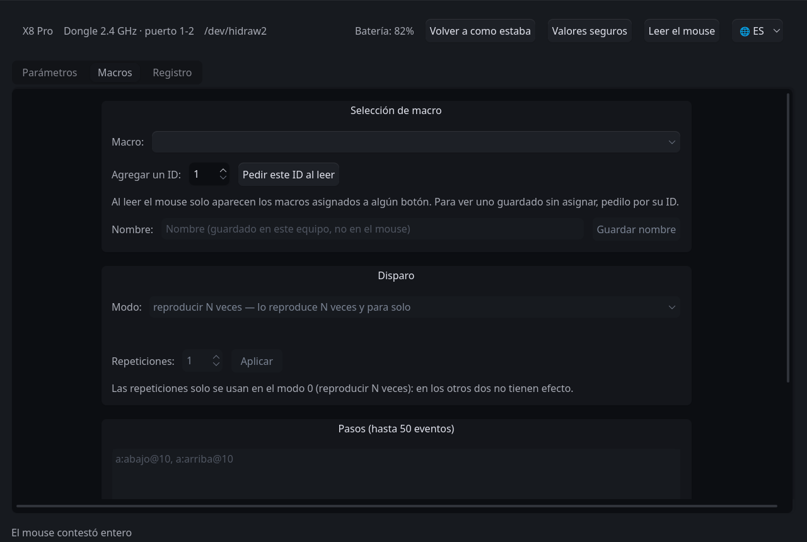

<p align="center"></p>

# LinShark — suite de configuración para Linux

**Español** · [English](README.en.md) · [简体中文](README.zh-CN.md)

Configura el mouse **sin el cliente oficial**: DPI, tasa de sondeo, botones,
macros, temporizadores de energía y registros del sensor, desde una interfaz
gráfica o desde la terminal. No requiere Windows, ni la plataforma web del
fabricante, ni el servicio auxiliar que esa plataforma exige y que solo existe
para Windows y macOS.

```
sudo ./instalar/install.sh      # una sola vez
linshark-gui                    # la aplicación
```

**Dónde se lee este archivo.** En el repositorio es `driver/README.md`, y el
instalador lo copia a `/opt/linshark/README.md`, junto con sus traducciones.
Las rutas relativas que aparecen —`./instalar/`, `scripts/`— son relativas a
ese directorio, sea cual sea de los dos.

El programa habla con el modelo cuyo perfil esté cargado. Hoy hay **uno
medido** —comprobado contra el mouse, no deducido—: el Attack Shark X8 Pro. Un
modelo que no se midió no existe para el programa; el procedimiento para
incorporar otro está en el directorio `dev/` del repositorio completo.

---

## Qué se puede cambiar en el X8 Pro

Los rangos los declara el perfil del modelo; estos son los del X8 Pro.

| Parámetro | Valores |
| :--- | :--- |
| Resolución | ocho niveles (seis cargados de fábrica), de 100 a 40 000 DPI en pasos de 50, y cuál está en uso |
| Tasa de sondeo | 125, 250, 500, 1000, 2000, 4000 y 8000 Hz por el dongle; hasta 1000 Hz por cable |
| Sensor | distancia de despegue (1 o 2 mm), control de fluctuación, corrección de ángulo, sincronización de movimiento |
| Tiempo de respuesta de los botones | 4 a 50 ms, en pasos de 2 |
| Botones | 18 slots, incluido el orden de la rueda; siempre queda un clic izquierdo en los botones 1 a 5 |
| Atajos de teclado | modificadores más una tecla, asignados a un botón |
| Macros | hasta 50 eventos por macro, con grabador en la ventana |
| Energía | reposo de 0,5 a 30 min; hibernación de 1 a 60 min |

Lo que no está en la tabla no se ofrece a propósito: ver
[Lo que este programa no hace](#lo-que-este-programa-no-hace).

---

## Requisitos

- **Linux** con `udev` y Python 3.10 o superior.
- **PySide6** para la interfaz gráfica. Si la distribución lo empaqueta
  (`python-pyside6`, `python3-pyside6`), el instalador utiliza ese paquete; en
  caso contrario lo obtiene mediante pip.
- El **dongle de 2.4 GHz**, o el mouse conectado **por cable**. Por cable la
  tasa de sondeo no supera los 1000 Hz (ver [Incidencias](#incidencias)).

## Instalación

```bash
sudo ./instalar/install.sh
```

Instala el programa en `/opt/linshark` y registra la **regla de `udev`**, que es
lo que permite comunicarse con el dispositivo sin privilegios de root. Deja en
el sistema:

| Qué | Dónde | Para qué |
| :--- | :--- | :--- |
| `linshark-gui` | `/usr/local/bin`, y en el menú de aplicaciones | la aplicación |
| `linshark` | `/usr/local/bin` | el [puente para la web oficial](#el-puente-para-la-plataforma-web); **no** es la aplicación |
| las herramientas de terminal | `/opt/linshark/scripts/` | ver [Línea de comandos](#línea-de-comandos); no quedan en el `PATH` |

| Operación | Orden |
| :--- | :--- |
| Simulación, sin modificar el sistema | `./instalar/install.sh --solo-probar` |
| Instalación en otra ruta | `sudo ./instalar/install.sh --prefijo /usr/local/lib/linshark` |
| Desinstalación | `sudo ./instalar/uninstall.sh` |

La desinstalación deja el sistema como estaba. No altera la configuración
escrita en el mouse ni los datos del usuario: `~/.config/linshark/` (nombres
de macro e idioma de la interfaz) y `~/.local/state/linshark/` (la lectura de
cada apertura y los respaldos de la terminal).

### Ejecución desde el repositorio

Con PySide6 disponible, y sin instalar nada, desde `driver/`:

```bash
sudo ./scripts/instalar-udev.sh      # la regla de permisos, igualmente necesaria
./linshark-gui
```

---

## La interfaz gráfica

```bash
linshark-gui                 # con su tema
linshark-gui --sin-tema      # con el tema del entorno de escritorio
linshark-gui --nodo /dev/hidraw2
```

### El primer uso

1. **Conectar el dongle** (o el cable) y abrir la aplicación. La barra superior
   dice por dónde está el mouse y en qué puerto.
2. **Si falta la regla de `udev`**, la ventana lo dice y ofrece instalarla con
   un botón.
3. **«Leer el mouse».** La aplicación no lee nada al abrirse: espera a que se lo
   pidan. Es el comportamiento opuesto al de los dos clientes oficiales, que al
   conectarse reescriben lo que leen. Con el mouse por encima de 1000 Hz, antes
   de leer baja la tasa un momento: ver [La tasa prestada](#la-tasa-prestada).
4. **Cambiar un campo.** Cada cambio se escribe solo, se relee y se compara; la
   línea de progreso dice cómo salió y la pestaña **Registro** lo detalla. La
   pantalla muestra lo que trajo la relectura; si no trajo nada, vuelve a lo
   último que se leyó, nunca a lo que se intentó escribir.

> **Riesgo.** Cada escritura queda en la memoria no volátil del mouse. Las
> verificaciones existen precisamente por eso, pero no anulan el riesgo: lo
> asume quien lo ejecuta.

### Qué hay en la ventana

- **Barra superior:** el modelo, el **camino de conexión y el puerto físico**
  («Dongle 2.4 GHz · puerto 1-2»), el nodo en uso, la batería, los botones de
  lectura y restauración, y el de idioma (**🌐**).
- **Parámetros:** una fila por campo, con el esquema del mouse sobre los
  botones. El **`?`** de cada fila explica qué es ese parámetro y para qué
  sirve. La función de un botón se elige **escribiendo** —«vol» ofrece subir y
  bajar el volumen, sin distinguir tildes ni mayúsculas— o **por grupo** (clics,
  desplazamiento, DPI, música y volumen, navegador…): basta abrir el desplegable
  o teclear con el foco encima.
- **Macros:** los macros almacenados en el dispositivo, con un grabador que
  captura las pulsaciones en vivo y muestra sus advertencias **antes** de
  escribir. Los nombres de los macros los guarda la aplicación en
  `~/.config/linshark/`: el mouse no tiene dónde guardarlos.
- **Registro:** cuanto se ha enviado al mouse y cuanto ha respondido.

La interfaz está en castellano, inglés y chino simplificado; la elección se
guarda en `~/.config/linshark/interfaz.json`.



### Restaurar

Dos botones restauran valores, y **ninguno de los dos toca los macros**, porque
un macro es trabajo de quien lo grabó:

| Botón | Qué escribe |
| :--- | :--- |
| **Volver a como estaba** | los valores que el mouse tenía al abrirse la ventana (quedan también en `~/.local/state/linshark/al-abrir.json`) |
| **Valores seguros** | los de fábrica, con la tasa de sondeo en 1000 Hz |

Antes de escribir nada, un diálogo enumera **qué campos van a cambiar y de qué
valor a qué valor**, y nombra los bloques que el dispositivo no llegó a
responder, que son los que quedarán sin restaurar.

### La tasa prestada

Es lo único que el programa modifica sin que se le pida, y por eso lo anuncia en
pantalla.

Por encima de 1000 Hz el dispositivo **no puede leerse por completo**
(comprobado a 2000 y a 8000 Hz: los bloques largos no llegan). Sin lectura
completa no hay respaldo, y sin respaldo no hay red de seguridad. Por eso,
cuando hace falta, la aplicación **reduce la tasa a 1000 Hz temporalmente**, lo
indica en un aviso persistente, y la restituye al cerrarse la ventana o tras 90
segundos sin cambios.

El aviso ofrece dos acciones:

- **Devolver la tasa ahora** — la restituye de inmediato.
- **Quedarme en 1000 Hz** — no escribe nada en el dispositivo, que ya está a esa
  tasa: cancela la devolución pendiente.

---

## Línea de comandos

Las herramientas de terminal viven en `scripts/`: en el repositorio,
`driver/scripts/`; instaladas, `/opt/linshark/scripts/`. **El instalador no las
pone en el `PATH`**, así que se corren por su ruta; los ejemplos suponen estar
en uno de esos dos directorios. Usan el `python3` del sistema y solo su
biblioteca estándar, salvo `medir-polling.py` y `medir-hibernacion.py`, que
necesitan además `evdev`.

Cada escritura sigue el mismo ciclo que la interfaz gráfica: respaldo,
confirmación, escritura, relectura y comparación. Los respaldos quedan en
`~/.local/state/linshark/respaldos/`. Como en la ventana, lo que se escribe
queda en la memoria no volátil del mouse.

```bash
scripts/respaldar.py                                  # respaldo completo
scripts/donde-esta-el-mouse.py                        # camino de conexión y puerto; no toca el mouse
scripts/cambiar-rate.py --valor 1000                  # únicamente la tasa
scripts/sondear.py --escuchar 20                      # escuchar, sin escribir
scripts/medir-polling.py --segundos 15                # la tasa real, cronometrada
scripts/medir-hibernacion.py --minutos 6              # cuándo entra en hibernación

scripts/primera-escritura.py --comando dpi --nivel 1 --valor 1600
scripts/primera-escritura.py --comando dpi --nivel-activo 2
scripts/primera-escritura.py --comando dpi --lod 2            # en milímetros
scripts/primera-escritura.py --comando luz --reposo 1
scripts/primera-escritura.py --comando botones --listar-funciones
scripts/primera-escritura.py --comando botones --boton costado-adelante --funcion adelante
scripts/primera-escritura.py --comando botones --boton costado-adelante \
    --funcion "atajo de teclado" --atajo ctrl+c
scripts/primera-escritura.py --comando macro --macro-id 17 \
    --eventos "a:abajo@10, a:arriba@10"

scripts/nombres-de-macro.py --poner 17 "copiar y pegar"
```

Los nombres de macro los almacena la aplicación en `~/.config/linshark/`, no el
dispositivo: el bloque de un macro carece de campo de nombre.

### Restaurar un bloque completo

Si un bloque queda con valores incoherentes, corregir campos sueltos no siempre
basta: cada escritura se apoya en lo que ya había, de modo que arrastra el error
contiguo. Para esos casos existe la vuelta atrás desde un respaldo:

```bash
scripts/restaurar-bloque.py --respaldo antes.json --comando luz
scripts/restaurar-bloque.py --respaldo antes.json --comando luz --solo-probar
```

Escribe el bloque **íntegro** tal como figuraba en ese respaldo, con la misma
verificación que el resto. Los bytes proceden exclusivamente del respaldo —no
hay forma de introducirlos a mano— y si el respaldo indicado ya contiene valores
inválidos, la herramienta se niega y lo explica.

---

## El puente para la plataforma web

`linshark` —sin `-gui`— no es la aplicación: es un servicio local que ocupa el
lugar del auxiliar del fabricante, para que su web funcione en Linux. Es como
empezó el proyecto, y se conserva aunque ya no es el objetivo:

```bash
linshark --backend hidraw --mode read
```

**Advertencia:** abrir esa página reescribe todo lo que lee y deja invertido el
desplazamiento de la rueda.

---

## Incidencias

**«El mouse está por cable».** Con el cable USB conectado al equipo, el mouse
deja de comunicarse por el dongle —comprobado: ni un solo latido en 32 s—, de
modo que la aplicación le habla por el cable y **la tasa de sondeo queda
limitada a 1000 Hz**, que es el techo del descriptor. Sucede aunque el selector
físico indique 2.4 GHz.

**«Faltan permisos sobre /dev/hidrawN».** Falta la regla de `udev`, o el dongle
se conectó antes de instalarla:

```bash
sudo ./scripts/instalar-udev.sh     # la instala y la aplica a lo ya conectado
```

Si el mensaje persiste, desconectar y volver a conectar el dongle.

**«No encuentro el mouse».** `scripts/donde-esta-el-mouse.py` informa de qué hay
en el bus: si se trata del cable, del dongle sin permisos, o de que no hay nada
conectado.

**Cada escritura tarda varios segundos.** Es deliberado: todo cambio se escribe,
se relee y se compara. La demora la impone el enlace de 2.4 GHz, que pierde
peticiones con el mouse inmóvil; moverlo durante la operación reduce el número
de reintentos.

**Tras abrir un cliente oficial, algo ha cambiado.** La web reescribe todo lo
que lee y el software nativo pisa el DPI, la corrección de ángulo y el tiempo
de respuesta. Conviene leer el dispositivo y revisar.

**«La lectura se contradice» o «el bloque tiene valores imposibles».** Por
cable, entre el 1 y el 2,5 % de las lecturas devuelve el contenido del bloque
anterior, porque el dispositivo dispone de un único búfer para todos los
reportes. Está comprobado; el programa lo detecta por cuatro vías independientes
y vuelve a solicitar el bloque. Si el mensaje aparece de todos modos, es que
insistió tres veces. **En ese caso no se escribe nada**, que es justamente el
objetivo: una lectura corrupta que alcanzara una escritura grabaría en el mouse
los bytes de otro bloque. Basta con reintentar.

**Un macro no se ejecuta.** Tres hechos comprobados: un macro de **un solo
evento** no se reproduce (con dos sí, y con tres también); un macro **sin botón
asignado** se guarda y se relee correctamente pero nada lo dispara; y el
firmware **no libera nada al terminar**, de modo que un macro que pulsa sin
soltar deja esa tecla trabada, y no se libera volviéndola a pulsar: hay que
desacoplar el dongle. La aplicación advierte de esto último antes de grabar.

---

## Lo que este programa no hace

- **No escribe nada que no se haya medido.** Cada byte enviado al dispositivo
  procede de una captura del cliente oficial, no de probar valores.
- **No reescribe el estado al conectarse**, ni al leer.
- **No modifica los macros al restaurar.**
- **No ofrece controles inertes.** Si un campo no produce efecto en el modelo
  conectado, no aparece, y el motivo queda escrito en el perfil. En el X8 Pro es
  el caso del color RGB: se escribe y el chasis no enciende nada.
- **No se comunica con un modelo que no se haya medido.** El código está
  preparado para varios, pero cada uno requiere que alguien capture su driver
  oficial: saber que un modelo existe no es saber comunicarse con él.
- **No cambia el método de conexión.** No es una limitación propia: ese comando
  tampoco existe en el cliente oficial. Se cambia con el botón del mouse.

El fundamento de cada una de esas reglas, con las mediciones que las respaldan,
está en el directorio `dev/` del repositorio completo.

---

## Apéndice: organización del código y pruebas

Para quien vaya a modificar el programa; para usarlo no hace falta.

```
src/linshark/                   la biblioteca: protocolo, estructuras, sesión, modelo
src/linshark/perfiles/          un perfil por modelo medido (hoy, uno: x8pro.py)
src/linshark_ui/                la interfaz gráfica (PySide6)
scripts/                        las herramientas de línea de comandos
models/                         lo propio de cada modelo, una carpeta por mouse
models/attackshark-x8pro/udev/  la regla que da acceso al canal de configuración
instalar/                       install.sh, uninstall.sh, el .desktop y el icono
docs/img/                       las capturas de este manual
tests/                          las pruebas, que no requieren hardware
```

Las pruebas se ejecutan sin dispositivo y sin ventana:

```bash
python3 tests/salvaguardas.py                          # el protocolo y las salvaguardas
python3 tests/simula_pagina.py                         # el puente, contra la web
QT_QPA_PLATFORM=offscreen python3 tests/interfaz.py    # la interfaz gráfica
```
