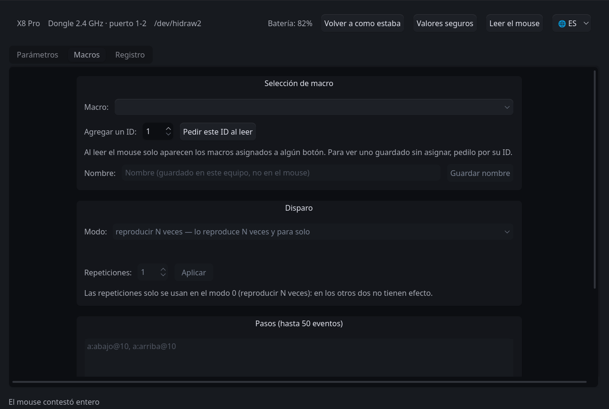

<!-- traduce: README.md sha256:47bdc3a422dcadc6f3066e4c2b6a35492b628a5d147b4d58073a5ad247a39390 -->
<p align="center"></p>

# LinShark：Linux 配置套件

[Español](README.md) · [English](README.en.md) · **简体中文**

> 本文是译文。原文是西班牙语的 [`README.md`](README.md)，西班牙语是本项目的工作语言：
> 两者不一致时，以西班牙语原文为准。

**无需官方客户端**即可配置鼠标：DPI、回报率、按键、宏、电源计时器和传感器寄存器，
可通过图形界面或终端完成。不需要 Windows，不需要厂商的网页平台，也不需要该平台所依赖、
且只有 Windows 和 macOS 版本的辅助服务。

```
sudo ./instalar/install.sh      # 只需一次
linshark-gui                    # 应用程序
```

**在哪里阅读本文件**。在仓库中它是 `driver/README.md`，安装程序会把它复制为
`/opt/linshark/README.md`，并把译文复制到同一目录。文中出现的相对路径（`./instalar/`、`scripts/`）都相对于该
目录，无论是两者中的哪一个。

程序与已加载配置档案的型号通信。目前只有**一个经过实测**的型号（对照鼠标检查过，而不是
推断出来的）：Attack Shark X8 Pro。没有实测过的型号对程序来说并不存在；添加其他型号的
流程在完整仓库的 `dev/` 目录中，只有西班牙语，这是有意的：那里是操作流程和证据，如果
那里的译文落后于原文，就可能有人按照理解错误的步骤向鼠标写入数据。

窗口已翻译；命令行工具及其输出信息为西班牙语。

---

## 在 X8 Pro 上可以更改什么

范围由型号的配置档案声明；以下是 X8 Pro 的范围。

| 参数 | 取值 |
| :--- | :--- |
| 分辨率 | 八个档位（出厂加载六个），100 至 40 000 DPI，步进 50，以及当前使用哪个档位 |
| 回报率 | 通过接收器 125、250、500、1000、2000、4000 和 8000 Hz；有线最高 1000 Hz |
| 传感器 | 静默高度（1 或 2 mm）、波纹控制、直线修正、动作同步 |
| 按键响应时间 | 4 至 50 ms，步进 2 |
| 按键 | 18 个槽位，包括滚轮的顺序；1 至 5 号键中始终保留一个左键 |
| 键盘快捷键 | 修饰键加一个按键，分配给某个按键 |
| 宏 | 每个宏最多 50 个事件，窗口中带有录制器 |
| 电源 | 浅度休眠 0.5 至 30 分钟；深度休眠 1 至 60 分钟 |

表中没有的功能是有意不提供的：见[本程序不做的事](#本程序不做的事)。

---

## 系统要求

- 带有 `udev` 的 **Linux**，以及 Python 3.10 或更高版本。
- 图形界面需要 **PySide6**。如果发行版提供该软件包（`python-pyside6`、
  `python3-pyside6`），安装程序会使用它；否则通过 pip 获取。
- **2.4 GHz 接收器**，或通过**线缆**连接的鼠标。有线连接时回报率不超过 1000 Hz
  （见[已知问题](#已知问题)）。

## 安装

```bash
sudo ./instalar/install.sh
```

它把程序安装到 `/opt/linshark`，并注册 **`udev` 规则**，这条规则使得无需 root 权限即可
与设备通信。它会在系统中留下：

| 内容 | 位置 | 用途 |
| :--- | :--- | :--- |
| `linshark-gui` | `/usr/local/bin`，以及应用菜单 | 应用程序 |
| `linshark` | `/usr/local/bin` | [官方网页的桥接](#网页平台桥接)；它**不是**应用程序 |
| 终端工具 | `/opt/linshark/scripts/` | 见[命令行](#命令行)；它们不会被加入 `PATH` |

| 操作 | 命令 |
| :--- | :--- |
| 模拟运行，不修改系统 | `./instalar/install.sh --solo-probar` |
| 安装到其他路径 | `sudo ./instalar/install.sh --prefijo /usr/local/lib/linshark` |
| 卸载 | `sudo ./instalar/uninstall.sh` |

卸载会让系统恢复原样。它不会改动已写入鼠标的设置，也不会改动用户数据：
`~/.config/linshark/`（宏名称和界面语言）和 `~/.local/state/linshark/`（每次打开时的
读取结果和终端工具的备份）。

### 从仓库直接运行

在已有 PySide6 的情况下，无需安装任何东西，在 `driver/` 中执行：

```bash
sudo ./scripts/instalar-udev.sh      # 权限规则，同样需要
./linshark-gui
```

---

## 图形界面

```bash
linshark-gui                 # 使用自带主题
linshark-gui --sin-tema      # 使用桌面主题
linshark-gui --nodo /dev/hidraw2
```

### 首次使用

1. **插入接收器**（或线缆）并打开应用。顶部栏会显示鼠标通过哪种方式、在哪个端口连接。
2. **如果缺少 `udev` 规则**，窗口会提示，并提供一个按钮来安装它。
3. **读取鼠标**。应用打开时不读取任何东西：它会等你要求。这与两个官方客户端正好相反，
   它们一连接就会重写读到的内容。如果鼠标高于 1000 Hz，读取之前会暂时降低回报率：见
   [临时借用的回报率](#临时借用的回报率)。
4. **修改一个字段**。每次修改都会立即写入、回读并比较；进度行会说明结果，**运行日志**
   页会给出细节。屏幕显示回读得到的值；如果回读没有得到任何结果，就回到上一次读到的值，
   绝不会显示试图写入的值。

> **风险**。每次写入都会留在鼠标的非易失性存储器中。这些检查正是为此而设，但它们不能
> 消除风险：风险由运行者自行承担。

### 窗口中有什么

- **顶部栏**：型号、**连接方式和物理端口**（“2.4 GHz 接收器 · 端口 1-2”）、正在使用的
  节点、电池、读取和恢复按钮，以及语言按钮（**🌐**）。
- **参数设置**：每个字段一行，按键上方有鼠标示意图。每行的 **`?`** 会解释该参数是什么、
  有什么用。按键的功能可以**通过输入**选择（输入“vol”会列出音量加和音量减，不区分重音
  和大小写），也可以**按分组**选择（点击、滚动、DPI、音乐与音量、浏览器等）：打开下拉
  列表，或在其获得焦点时直接输入即可。
- **宏管理**：设备中存储的宏，带有一个录制器，可实时捕获按键，并在写入**之前**显示
  警告。宏名称由应用保存在 `~/.config/linshark/` 中：鼠标没有地方存储它们。
- **运行日志**：发送给鼠标的所有内容，以及它的所有回应。

界面提供西班牙语、英语和简体中文；所选语言保存在 `~/.config/linshark/interfaz.json`。



### 恢复

有两个按钮用于恢复数值，**两个都不会动宏**，因为宏是录制者的劳动成果：

| 按钮 | 写入什么 |
| :--- | :--- |
| **恢复打开时的状态** | 窗口打开时鼠标的数值（同时保存在 `~/.local/state/linshark/al-abrir.json`） |
| **安全默认值** | 出厂数值，回报率设为 1000 Hz |

在写入任何东西之前，会有一个对话框列出**哪些字段将会改变、从哪个值变为哪个值**，并指出
设备没有响应的数据块，也就是将不会被恢复的部分。

### 临时借用的回报率

这是程序唯一会在未经要求时改变的东西，因此它会在屏幕上说明。

高于 1000 Hz 时设备**无法被完整读取**（在 2000 和 8000 Hz 下检查过：较长的数据块无法
到达）。没有完整读取就没有备份，没有备份就没有安全网。因此在需要时，应用会**暂时把
回报率降到 1000 Hz**，用一个常驻提示说明，并在窗口关闭时或 90 秒无改动后恢复。

提示提供两个操作：

- **立即恢复回报率**：马上恢复。
- **保持在 1000 Hz**：不向设备写入任何东西（设备已经处于该回报率），只取消待执行的恢复。

---

## 命令行

终端工具位于 `scripts/`：在仓库中是 `driver/scripts/`，安装后是
`/opt/linshark/scripts/`。**安装程序不会把它们加入 `PATH`**，因此要按路径运行；示例
假定你位于这两个目录之一。它们使用系统的 `python3`，只用其标准库，但 `medir-polling.py`
和 `medir-hibernacion.py` 还需要 `evdev`。它们的选项和输出信息为西班牙语。

每次写入都遵循与图形界面相同的流程：备份、确认、写入、回读和比较。备份保存在
`~/.local/state/linshark/respaldos/`。与窗口中一样，写入的内容会留在鼠标的非易失性
存储器中。

```bash
scripts/respaldar.py                                  # 完整备份
scripts/donde-esta-el-mouse.py                        # 连接方式和端口；不接触鼠标
scripts/cambiar-rate.py --valor 1000                  # 只改回报率
scripts/sondear.py --escuchar 20                      # 只监听，不写入
scripts/medir-polling.py --segundos 15                # 实际回报率，计时测得
scripts/medir-hibernacion.py --minutos 6              # 何时进入深度休眠

scripts/primera-escritura.py --comando dpi --nivel 1 --valor 1600
scripts/primera-escritura.py --comando dpi --nivel-activo 2
scripts/primera-escritura.py --comando dpi --lod 2            # 单位为毫米
scripts/primera-escritura.py --comando luz --reposo 1
scripts/primera-escritura.py --comando botones --listar-funciones
scripts/primera-escritura.py --comando botones --boton costado-adelante --funcion adelante
scripts/primera-escritura.py --comando botones --boton costado-adelante \
    --funcion "atajo de teclado" --atajo ctrl+c
scripts/primera-escritura.py --comando macro --macro-id 17 \
    --eventos "a:abajo@10, a:arriba@10"

scripts/nombres-de-macro.py --poner 17 "copiar y pegar"
```

宏名称由应用保存在 `~/.config/linshark/` 中，而不是由设备保存：宏的数据块没有名称字段。

### 恢复整个数据块

如果某个数据块出现了互相矛盾的数值，逐个修正字段并不总是够用：每次写入都建立在已有内容
之上，因此会把相邻的错误一起带过去。针对这种情况，可以从备份回退：

```bash
scripts/restaurar-bloque.py --respaldo antes.json --comando luz
scripts/restaurar-bloque.py --respaldo antes.json --comando luz --solo-probar
```

它会按该备份中的样子写入**整个**数据块，验证方式与其他写入相同。字节只来自备份（没有办法
手动输入），如果指定的备份本身已包含无效数值，工具会拒绝并说明原因。

---

## 网页平台桥接

`linshark`（不带 `-gui`）不是应用程序：它是一个本地服务，用来顶替厂商的辅助服务，让厂商
的网页能在 Linux 上工作。本项目就是从它开始的，虽然它已不再是目标，但仍被保留：

```bash
linshark --backend hidraw --mode read
```

**警告**：打开那个网页会重写它读到的一切，并把滚轮方向反转。

---

## 已知问题

**“鼠标通过 USB 线连接”**。当 USB 线连接到电脑时，鼠标不再通过接收器通信（检查过：32 秒
内没有一次心跳），因此应用会通过线缆与它通信，**回报率被限制在 1000 Hz**，这是描述符的
上限。即使物理开关显示 2.4 GHz 也是如此。

**/dev/hidrawN 上“缺少该节点的权限”**。缺少 `udev` 规则，或者接收器是在安装规则之前插入的：

```bash
sudo ./scripts/instalar-udev.sh     # 安装规则，并应用到已插入的设备
```

如果提示仍然存在，拔下接收器再重新插入。

**找不到鼠标**。`scripts/donde-esta-el-mouse.py` 会报告总线上有什么：是线缆、没有权限的
接收器，还是什么都没有连接。

**每次写入需要几秒钟**。这是有意的：每次修改都会写入、回读并比较。延迟来自 2.4 GHz
连接，鼠标静止时它会丢失请求；在操作期间移动鼠标可以减少重试次数。

**打开官方客户端后，有些东西变了**。网页会重写它读到的一切，原生软件会覆盖 DPI、直线
修正和响应时间。请读取设备并检查。

**“该次读取自相矛盾”或“该数据块含有不可能的值”**。有线连接时，1% 至 2.5% 的读取会返回
上一个数据块的内容，因为设备所有报告共用一个缓冲区。这是检查过的；程序通过四种独立方式
检测它，并重新请求该数据块。如果提示仍然出现，说明它已经坚持了三次。**这种情况下不会
写入任何东西**，这正是目的所在：一次损坏的读取如果到达写入，就会把另一个数据块的字节写进
鼠标。重试即可。

**宏不执行**。三个检查过的事实：**只有一个事件**的宏不会执行（两个可以，三个也可以）；
**没有分配按键**的宏能正确保存和回读，但没有东西能触发它；并且固件在宏结束时**不会释放
任何按键**，所以一个按下而不松开的宏会让那个键卡住，再按一次也不会释放：必须拔下接收器。
应用会在录制前就后者发出警告。

---

## 本程序不做的事

- **不写入任何未经实测的东西**。发送给设备的每个字节都来自对官方客户端的捕获，而不是
  来自试值。
- **连接时不重写状态**，读取时也不会。
- **恢复时不改动宏。**
- **不提供无效控件**。如果某个字段在所连接的型号上没有效果，它就不会出现，原因写在配置
  档案中。在 X8 Pro 上 RGB 颜色就是这种情况：会被写入，但机身不会亮起任何灯光。
- **不与未经实测的型号通信**。代码已为多个型号做好准备，但每一个都需要有人捕获其官方
  驱动：知道一个型号存在，并不等于知道如何与它通信。
- **不切换连接方式**。这不是本程序自身的限制：官方客户端中也不存在这个命令。需要用鼠标
  上的按键切换。

以上每条规则的依据及支撑它们的测量结果，见完整仓库的 `dev/` 目录（西班牙语）。

---

## 附录：代码结构与测试

面向要修改程序的人；使用程序不需要这些。

```
src/linshark/                   库：协议、数据结构、会话、模型
src/linshark/perfiles/          每个已实测型号一个配置档案（目前只有一个：x8pro.py）
src/linshark_ui/                图形界面（PySide6）
scripts/                        命令行工具
models/                         各型号专属的内容，每个鼠标一个文件夹
models/attackshark-x8pro/udev/  授予配置通道访问权限的规则
instalar/                       install.sh、uninstall.sh、.desktop 文件和图标
docs/img/                       本手册中的截图
tests/                          测试，不需要硬件
```

测试无需设备、无需窗口即可运行：

```bash
python3 tests/salvaguardas.py                          # 协议和安全措施
python3 tests/simula_pagina.py                         # 桥接，对照网页
QT_QPA_PLATFORM=offscreen python3 tests/interfaz.py    # 图形界面
```
